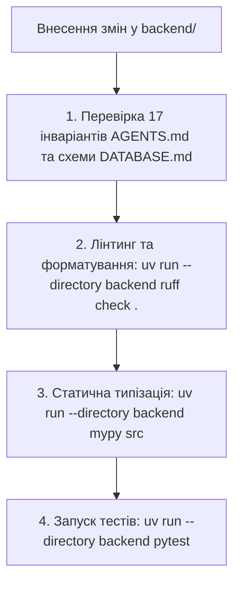

# ⚙️ Бекенд-регламент: Обов'язковий самоконтроль та інваріанти (AGENTS.md)

Цей регламент є обов'язковим для **будь-яких дій та змін у каталозі `backend/`** (включаючи ядро, бізнес-модулі, фонові задачі ARQ, міграції Alembic, Telegram-бот та тести).
Після **кожного** внесення змін до коду агент зобов'язаний верифікувати результати за наведеним нижче протоколом та звірити їх із конституцією проєкту **[`AGENTS.md`](../../AGENTS.md)** та схемою **[`docs/DATABASE.md`](../../docs/DATABASE.md)**.

---

## 1. 🔄 Протокол перевірки після КОЖНОГО внесення змін

Після зміни, додавання або рефакторингу файлів у `backend/` агент зобов'язаний виконати послідовну перевірку:

---

## 2. 🛡️ 17 Обов'язкових архітектурних інваріантів бекенду

Кожне редагування перевіряється на суворе дотримання наступних інваріантів:

1. **Ніяких внутрішніх міжмодульних імпортів у Write-пайплайні (Domain, Application, Repositories):**
   * ❌ `from src.modules.finance.infrastructure.models import ExchangeRateModel`
   * ❌ `from src.modules.users.application.use_cases import UpdateSettingsUseCase`
   * ✅ `from src.modules.finance.public import FinancePublicGateway`
   * *Виняток:* `QueryService` (Read Side) має право імпортувати ORM-моделі інших модулів виключно для побудови SQL `SELECT / JOIN`.
2. **Rich Domain та заборона прямої мутації доменних моделей:**
   * Зміна стану сутності дозволена виключно через її доменні методи (наприклад, `subscription.record_payment()`, `medication.complete_course()`), а не прямим присвоєнням атрибутів.
   * Будь-які модифікуючі методи агрегатів зобов'язані валідувати активність сутності через `self.ensure_active(...)`.
3. **Single Table Inheritance (STI) у БД проти Чистих Агрегатів у Домені:**
   * У БД всі нагадування зберігаються в одній таблиці `reminders`, але на рівні домену розгортаються через `ReminderMapper` у 5 окремих агрегатів (`AnniversaryReminder`, `OpenTaskReminder`, `DeadlineTaskReminder`, `SubscriptionReminder`, `MedicationReminder`).
   * Валідація сумісності `(reminder_type, schedule_logic)` виконується в домені (`IncompatibleScheduleLogicError`).
4. **Безстатусна часова проекція для `lead_times` (Time-Series Projection):**
   * Жодних числових індексів `lead_time_index` у БД. Наступний час `next_trigger_at` обчислюється через проекцію часових зміщень від $T_{\text{target}}$ та вибір найменшої точки $T_k > T_{\text{current}}$.
5. **Обов'язкове `lazy="raise"`:**
   * Усі зв'язки `relationship()` в ORM-моделях SQLAlchemy зобов'язані містити аргумент `lazy="raise"`.
6. **`QueryService` тільки для читання:**
   * Жодних операцій запису (`INSERT`, `UPDATE`, `DELETE`) або мутацій стану в класах `QueryService`.
7. **Контроль транзакцій (`uow.commit()`):**
   * Викликати `await uow.commit()` дозволено **тільки кореневому Use Case / Application Service** (або функції крон-задачі ARQ). Вкладені виклики шлюзів з `external_uow`, роутери, хендлери бота, репозиторії та доменні моделі ніколи не роблять коміт.
8. **Розв'язка Бекенду/ARQ від Telegram SDK:**
   * Домен та воркери ARQ не викликають `aiogram` напряму, а публікують `NotificationPayload` у чергу Redis (`LPUSH queue:notifications:telegram`).
9. **Логування тільки через Loguru:**
   * Використовувати виключно `from loguru import logger` (або `from src.core import logger`). Виклики `print()` або стандартного модуля `logging` суворо заборонені.
10. **Семантика HTTP PUT vs PATCH:**
    * У PUT-запитах передаються всі поля сутності (Full Update); частковий перезапис (`exclude_unset=True`) у PUT заборонено.
    * Точкові оновлення реалізуються через PATCH з окремим DTO, а переходи станів / дії — через окремі POST RPC-ендпоінти.
11. **Обов'язкове оптимістичне блокування (OCC) через `version`:**
    * Усі змінювані таблиці (`users`, `user_telegram_accounts`, `user_settings`, `reminders`, `medication_intake_logs`) містять `version: Mapped[int]` та `__mapper_args__ = {"version_id_col": version}`.
    * Конфлікти версій транслюються в `HTTP 409 Conflict` (`OPTIMISTIC_LOCK_CONFLICT`).
12. **Стандарт системних полів та UUIDv7:**
    * Усі первинні ключі — суворо **UUIDv7** (RFC 9562).
    * Усі часові мітки — UTC `TIMESTAMPTZ`.
    * `deleted_at` присутнє тільки в `users`, `reminders` та `medication_intake_logs` (відсутнє в `user_settings`, `user_telegram_accounts` та append-only `exchange_rates`).
13. **Розподіл Soft Delete та Hard Delete:**
    * **HTTP DELETE — Hard Delete:** Фізичне видалення рядка з БД (`DELETE FROM ...` з `ON DELETE CASCADE`).
    * **HTTP PATCH / Доменна дія — Soft Delete:** Проставлення `deleted_at = now_utc()`. Усі вибірки активних даних та шедулера обов'язково містять `WHERE deleted_at IS NULL`.
14. **Стандарти Pydantic v2 (`typing.Annotated`) та Конфігурації (`APP_CONFIG__`):**
    * Усі поля моделей валідації та DTO Pydantic описуються через `typing.Annotated[T, Field(...)]`. Застарілий синтаксис `field: T = Field(...)` заборонено.
    * Змінні оточення `pydantic-settings` мають префікс `APP_CONFIG__` та роздільник `__`.
15. **Стандарт пакетних фасадів (`__all__`) та Strict No-Proxy / SSOT:**
    * Публічний API підпакетів та міжмодульних шлюзів (`public.py`) експортується через `__init__.py` за допомогою `__all__`.
    * Категорично заборонено додавати `__all__` у внутрішні файли реалізації та залишати старі файли-прошарки при рефакторингу.
16. **Ізоляція тестової бази даних (`reminder_app_test`) та Savepoint Rollback:**
    * Усі тести виконуються виключно у виділеній БД `reminder_app_test` з відкатом транзакцій через `savepoint`. Робоча БД не чіпається.
17. **Обов'язковий запуск інструментів через `uv run`:**
    * Будь-які консольні команди (`ruff`, `mypy`, `pytest`, `alembic`, `pre-commit`) запускаються тільки через `uv run --directory backend ...`.

---

## 3. 📝 Чек-лист самоконтролю перед фінальним звітом

Перед тим як повідомити користувача про завершення роботи над задачею, агент зобов'язаний перевірити кожний пункт:

- [ ] 1. **Імпорти та Фасади:** Немає заборонених міжмодульних імпортів у Write-пайплайні; імпорти виконуються з пакетних фасадів (`src.core`, `public.py`), без проксі-файлів.
- [ ] 2. **Rich Domain & STI:** Модифікації стану інкапсульовані в методах 5 доменних агрегатів із викликом `ensure_active(...)`.
- [ ] 3. **Time-Series & Quiet Hours:** Каскад `lead_times` розраховується без індексів у БД; для ліків із `strict_schedule = True` тихі години ігноруються.
- [ ] 4. **Фінансовий Fallback:** При віці курсу банку > 48 годин автоматично використовується курс НБУ з відповідним прапорцем попередження.
- [ ] 5. **Транзакційність та OCC:** `await uow.commit()` викликається тільки в кореневому Use Case; змінювані моделі мають `version` та обробку `HTTP 409 Conflict`.
- [ ] 6. **Pydantic v2:** Усі DTO використовують `Annotated[T, Field(...)]` без `= Field(...)`.
- [ ] 7. **Ruff:** `uv run --directory backend ruff check .` повертає 0 помилок.
- [ ] 8. **MyPy:** `uv run --directory backend mypy src` повертає 0 помилок.
- [ ] 9. **Pytest:** Усі відповідні тести (`tests/unit`, `tests/integration`, `tests/api`) проходять на 100%.
