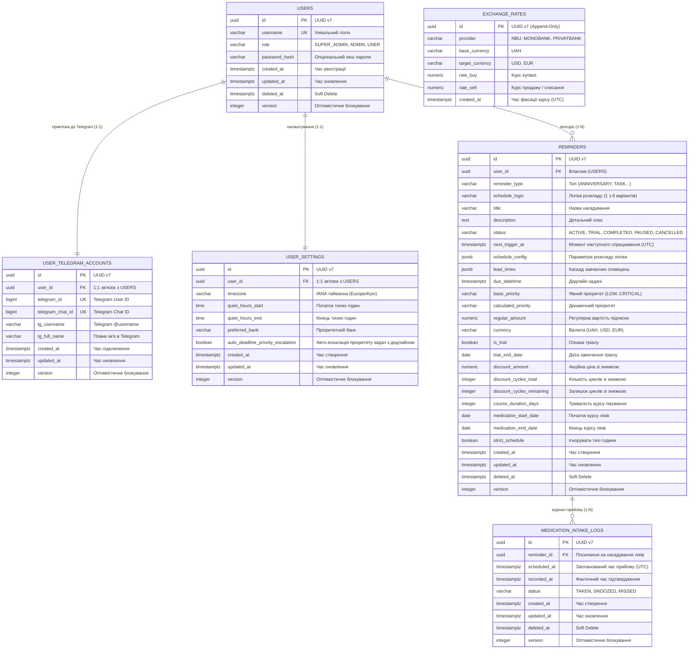
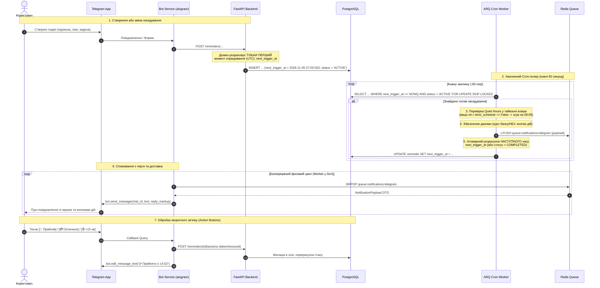

# Архітектура системи: Reminder App (Modular Monolith + CQRS)

Цей документ описує технічну архітектуру, мультикористувацьку модель даних, взаємодію сервісів, обґрунтування вибору технологічного стека та структуру бекенду для персонального сервісу нагадувань.

---

## 1. Загальна схема системи (Container & Deployment View)

Усі компоненти розгортаються на одному VPS в єдиній ізольованій мережі **Docker Network**. Жоден сервіс (крім SSH) **не виставляє порти назовні**.

```mermaid
flowchart TD
    User([Користувач / Telegram Клієнт]) <-->|Telegram App| TGServers[Сервери Telegram API]
    
    subgraph Host["VPS / Server (Ізольована Docker Network)"]
        subgraph BotService["Bot Container (aiogram 3.x)"]
            TGBot[aiogram Polling Handler]
            NotifyConsumer[Notification Worker / Consumer]
        end

        subgraph BackendService["Backend Container (FastAPI)"]
            API[FastAPI REST API]
            QueryService[CQRS Read: Direct SQL Projections]
            DomainWrite[CQRS Write: Domain Aggregates + Repositories]
        end

        subgraph WorkerService["Background Tasks Container (ARQ)"]
            ARQCron[ARQ Cron & Scheduling]
            ARQTasks[Background Workers]
        end

        Postgres[(PostgreSQL 16)]
        Redis[(Redis 7)]
    end

    subgraph ExternalBanks["Зовнішні банківські API"]
        NBU[NBU API - Офіційний курс]
        Mono[Monobank API - Картковий курс]
        Privat[PrivatBank API - Картковий курс]
    end

    TGServers <-->|Long Polling (Вихідний HTTPS)| TGBot
    TGBot -->|HTTP REST Client (httpx)| API
    
    API -->|Async Read| Postgres
    API -->|Async Write / Unit of Work| Postgres
    API -->|Enqueue Jobs| Redis
    
    ARQCron -->|Cron Check Reminders| Postgres
    ARQTasks -->|Fetch Rates Daily| ExternalBanks
    ARQTasks -->|Save Rates| Postgres
    ARQTasks -->|Publish Notification Event| Redis
    
    Redis -->|Redis Stream / BRPOP| NotifyConsumer
    NotifyConsumer -->|Send Message with Buttons| TGServers
```

---

## 2. Ключові архітектурні принципи

### 2.1. Мультикористувацька архітектура (Multi-User by Design)
Незважаючи на те, що сервіс self-hosted, архітектура із самого початку будується як **мультикористувацька**:
* Усі таблиці містять зовнішній ключ `user_id`.
* Дані користувача чітко декомпоновано:
  * `users` — ядро ідентифікації (`id`, `username`, `role`, опціональний `password_hash`).
  * `user_telegram_accounts` — прив'язка 1:1 до месенджера (`telegram_id`, `telegram_chat_id`, `tg_username`, `tg_full_name`).
  * `user_settings` — персональні налаштування 1:1: таймзона (IANA, наприклад `Europe/Kyiv`), вікно тихих годин, обраний банк для курсів валют та перемикач `auto_deadline_priority_escalation`.
* Розрахунок часу спрацювання нагадувань і перевірка тихих годин завжди виконуються **в контексті часового поясу конкретного користувача**, тоді як у БД всі таймстемпи зберігаються строго в **UTC (`TIMESTAMPTZ`)**.

### 2.2. Розв'язка бекенда від Telegram (Redis Delivery Queue)
Бекенд та фоновий шедулер ARQ нічого не знають про Telegram SDK:
1. ARQ-задача, визначивши, що настав час нагадування, формує стандартизований DTO:
   ```python
   class NotificationPayload(BaseModel):
       recipient_channel: str = "telegram"
       recipient_chat_id: int
       title: str
       body: str
       buttons: list[ActionButton] = []
       disable_sound: bool = False
   ```
2. Подія публікується в Redis: `LPUSH queue:notifications:telegram <json>`.
3. Окремий легкий воркер всередині контейнера бота читає чергу через блокуючий `BRPOP queue:notifications:telegram` і надсилає повідомлення через `bot.send_message(...)`.
4. Якщо контейнер бота перезавантажується — жодне нагадування не втрачається, воно безпечно очікує в Redis.

### 2.3. Безпека без Nginx та доменів
* Бот працює через **Long Polling** (сам робить вихідні HTTPS-запити до серверів Telegram).
* Жодних відкритих портів у світ (`ports` у `docker-compose.yml` не публікуються для зовнішнього доступу).
* Для доступу до Swagger UI (`/docs`) використовується безпечний SSH-тунель:
  ```bash
  ssh -L 8000:localhost:8000 user@your-vps-ip
  ```

---

## 3. Схема бази даних (PostgreSQL 16) — Single Table Inheritance (STI), Декомпозиція та UUID v7

Для забезпечення максимальної продуктивності, масштабованості та надійності в базі даних застосовано ключові архітектурні патерни:
* **UUID v7 для всіх Primary Key (RFC 9562)**: завдяки наявності 48-бітного мілісекундного таймстампу на початку значення, UUID v7 є монотонно зростаючим у часі, що усуває фрагментацію B-Tree індексів у PostgreSQL і прискорює операції вставки до швидкості цілих чисел, зберігаючи глобальну унікальність.
* **Декомпозиція сутностей користувача**:
  * `USERS` — ядро ідентифікації з ролями (`role: SUPER_ADMIN, ADMIN, USER`) та опціональним `password_hash` для майбутньої веб-панелі/API.
  * `USER_TELEGRAM_ACCOUNTS` — виділена таблиця зв'язку 1:1 для Telegram (`telegram_id`, `telegram_chat_id`, `tg_username`, `tg_full_name`), що ізолює бізнес-домен від конкретного месенджера.
  * `USER_SETTINGS` — виділена таблиця налаштувань 1:1 (`timezone`, `quiet_hours_start`, `quiet_hours_end`, `preferred_bank`, `auto_deadline_priority_escalation`).
* **Аудит, Soft Delete, Hard Delete та Optimistic Concurrency Control (OCC)**:
  * Усі модифіковані таблиці містять `created_at`, `updated_at`, `deleted_at` та `version`.
  * Підтримуються два рівні видалення: **Soft Delete** (заповнення `deleted_at = NOW()` для приховування сутностей без порушення реляційної цілісності пов'язаних даних) та **Hard Delete** (фізичне видалення через `DELETE` з каскадним очищенням `ON DELETE CASCADE` при повному скиданні чи видаленні акаунта).
  * Поле `version` реалізує оптимістичне блокування для захисту від стану гонитви між діями користувача і фоновим воркером.
* **Append-Only історія курсів валют (`EXCHANGE_RATES`)**:
  * Таблиця зберігає повну ретроспективу курсів, без перезапису, забезпечуючи локальну історію динаміки для аналітики та графіків.
* **Single Table Inheritance для Нагадувань (`REMINDERS`)**:
  * Усі типи нагадувань зберігаються в **одній таблиці `REMINDERS`** з колонками-дискримінаторами `reminder_type` та `schedule_logic`.
  * **Перевага**: щохвилинний запит шедулера:
    ```sql
    SELECT * FROM reminders 
    WHERE next_trigger_at <= NOW() 
      AND status IN ('ACTIVE', 'TRIAL') 
      AND deleted_at IS NULL 
    ORDER BY next_trigger_at ASC 
    LIMIT 100 
    FOR UPDATE SKIP LOCKED;
    ```
    опитує **один частковий індекс однієї таблиці**, не навантажуючи БД ресурсомісткими `UNION ALL`.
* **DDD-чистота на бекенді**: у доменному шарі FastAPI кожен тип залишається окремим строгим агрегатом (`AnniversaryReminder`, `OpenTaskReminder`, `DeadlineTaskReminder`, `SubscriptionReminder`, `MedicationReminder`) зі своїми бізнес-правилами та валідацією дозволених логік планування.



### Деталі колонок JSONB та реалізація 6 Логік Планування:

1. **Логіка 1 (`DateWithMonthInterval`)**:
   * `{"type": "month_interval", "day": 31, "interval_months": 1, "end_of_month_policy": "last_day_of_month"}`
2. **Логіка 2 (`DailyAtTimes`)**:
   * `{"type": "daily_times", "times": ["08:00", "14:00", "20:00"]}`
3. **Логіка 3 (`ExactDateTimeDeadline`)**:
   * `{"type": "exact_datetime", "due_datetime": "2026-11-15T18:00:00Z"}`
4. **Логіка 4 (`ExactDateDeadline`)**:
   * `{"type": "exact_date", "due_date": "2026-11-15", "default_notify_time": "09:00:00"}`
5. **Логіка 5 (`IntervalDays`)**:
   * `{"type": "interval_days", "days": 28}`
6. **Логіка 6 (`IntervalHours`)**:
   * `{"type": "interval_hours", "hours": 8, "first_trigger": "08:00:00"}`
7. **`lead_times` (Завчасні сповіщення для Річниць та Підписок)**:
   * Масив відносних зміщень до цільової дати: `["14d", "7d", "3d", "1d", "0d"]` або `["5d", "3d", "1d"]` для тріалу.

---

## 4. Фінансовий контекст: Мультибанківські курси та Fallback-політика

### 4.1. Джерела даних
* **НБУ (Національний банк України)**:
  * API: `https://bank.gov.ua/NBUStatService/v1/statdirectory/exchange?json`
  * Пріоритет: **1 (Гарантований золотий стандарт)**.
  * Оновлення: 1 раз на добу після 15:30.
* **Monobank**:
  * API: `https://api.monobank.ua/bank/currency` (курс списання за картками).
  * Rate limit: суворо 1 запит на 60 секунд. Опитується cron-задачею раз на 4–6 годин.
* **ПриватБанк**:
  * API: `https://api.privatbank.ua/p24api/pubinfo?json&exchange&coursid=5` (картковий курс).

### 4.2. Алгоритм Staleness & Fallback
1. Користувач обирає у налаштуваннях `preferred_bank` (наприклад, `MONOBANK`).
2. Під час формування нагадування для суми у валюті (`USD`/`EUR`):
   * Витягується найновіший запис з append-only таблиці `EXCHANGE_RATES` (`WHERE provider = user_settings.preferred_bank ORDER BY created_at DESC LIMIT 1`).
   * Перевіряється свіжість: `is_stale = (now_utc - rate.created_at) > 48 hours`.
3. Якщо `is_stale = False`:
   * Розрахунок ведеться за `rate_sell` обраного банку (реальний курс списання).
4. Якщо `is_stale = True` (банківське API віддавало помилки понад 2 дні):
   * Витягується найсвіжіший курс `provider = NBU`.
   * Сума перераховується за офіційним курсом НБУ.
   * До повідомлення додається явне попередження користувачеві про застарілість банківського курсу.

---

## 5. End-to-End Pipeline: Пошук, обробка та доставка нагадувань

Цей розділ описує повний життєвий цикл нагадування: від створення через базу даних, крон-полер і чергу до телефону користувача та обробки натискання кнопок.



### Детальний опис етапів пайплайну:

#### Етап 1: Принцип прекалькуляції часу (`next_trigger_at`)
* Ми **не обчислюємо складні правила повторення на льоту** для всіх рядків бази кожну хвилину.
* Натомість кожне нагадування має колонку `next_trigger_at: TIMESTAMPTZ` з індексом `B-Tree` (`CREATE INDEX idx_reminders_due ON ... (next_trigger_at) WHERE status = 'ACTIVE'`).
* При створенні нагадування доменний шар розраховує перший точний момент спрацювання (в UTC) і зберігає його в цю колонку.

#### Етап 2: Хвилинний Cron-полер (`ARQ Worker`)
Кожні 60 секунд фоновий процес запускає SQL-запит:
```sql
SELECT id, user_id, reminder_type, payload, version
FROM reminders
WHERE next_trigger_at <= NOW()
  AND status IN ('ACTIVE', 'TRIAL')
  AND deleted_at IS NULL
ORDER BY next_trigger_at ASC
LIMIT 100
FOR UPDATE SKIP LOCKED;
```
* **Захист від збоїв сервера (`<= NOW()`)**: якщо VPS перезавантажувався або був вимкнений 15 хвилин, після ввімкнення жодне нагадування не зникне — запит вибере всі прострочені записи та доставить їх користувачеві.
* **Захист від дублювання (`FOR UPDATE SKIP LOCKED`)**: блокування на рівні рядків гарантує, що кілька паралельних воркерів ніколи не візьмуть один і той самий запис.

#### Етап 3: Пайплайн фільтрації та тихих годин (Quiet Hours Pipeline)
Для кожного відібраного нагадування виконується перевірка:
1. Завантажуються налаштування користувача: `user.timezone`, `user.quiet_hours_start`, `user.quiet_hours_end`.
2. Поточний час конвертується в локальний часовий пояс користувача.
3. Якщо поточний локальний час потрапляє у проміжок тиші:
   * **Якщо `strict_schedule == False`**: нагадування **не відправляється зараз**. Поле `next_trigger_at` просто зсувається на ранковий час закінчення тихих годин: `user.quiet_hours_end + 5 хвилин`.
   * **Якщо `strict_schedule == True`** (критичні ліки): перевірка тихих годин ігнорується, нагадування надсилається негайно.

#### Етап 4: Збагачення даними (Data Enrichment)
* **Для валютних підписок**: витягується актуальний курс обраного банку (з перевіркою >48 годин і фолбеком на НБУ при необхідності), формується рядок: `Spotify: $9.99 (~415 грн за курсом Monobank)`.
* **Для ліків**: підраховується поточний день курсу («День 3 з 10, прийом 2 з 3»).
* **Для дедлайн-задач**: якщо пріоритет `UNSET` і в налаштуваннях `user_settings.auto_deadline_priority_escalation == True`, розраховується коефіцієнт $R$ і призначається динамічний пріоритет (додається бейдж терміновості `[КРИТИЧНО]`). Якщо пріоритет вказано явно або опцію вимкнено — динамічний перерахунок не перезаписує пріоритет.
* **Для Open задач**: використовується явно заданий пріоритет (якщо вказано) для сортування в дайджесті.
* **Формування кнопок дій**: генеруються інлайн-кнопки (`[💊 Прийняв]`, `[⏰ +15 хв]`, `[💳 Оплачено]`, `[❌ Скасував тріал]`).

#### Етап 5: Атомарний перерахунок наступної дати (Time-Series Projection)
У тій же транзакції бази даних виконується перерахунок без використання крихких числових індексів елементів:
* **Для подій із `lead_times` (Річниці, Підписки, Дедлайн-задачі)**:
  * Програма будує хронологічний часовий ряд точок від цільової дати події: $T_k = T_{\text{target}} - \text{offset}_k$.
  * Наступним часом обирається найближча точка, строго більша за щойно виконану: $T_{\text{next}} = \min(\{T_k \mid T_k > T_{\text{current}}\})$.
  * Якщо користувач посеред циклу додає або видаляє зміщення з `lead_times`, система автоматично перераховує часовий ряд і бере найменшу точку, де $T_k > \text{NOW()}$, що повністю виключає розсинхрон або вихід за межі масиву.
  * Якщо всі точки поточного циклу вичерпано (спрацював "0d"):
    * Для циклічних подій (річниці, підписки) цільова дата події $T_{\text{target}}$ зсувається на наступний календарний період (+1 місяць або +12 місяців), і каскад відновлюється з першої точки нового циклу.
    * Для разових задач з дедлайном статус оновлюється на `COMPLETED` або `OVERDUE`.
* **Для ліків та щоденних задач (`schedule_config` без lead_times)**:
  * Береться наступний час із масиву `times` або додається `interval_hours`.
  * Якщо курс завершено (`NOW() > medication_end_date`), статус переводиться у `COMPLETED`. Для безстрокових ліків (`end_date = NULL`) цикл продовжується нескінченно.
* Запис оновлюється: `UPDATE reminders SET next_trigger_at = :new_trigger, version = version + 1, updated_at = NOW() WHERE id = :id AND version = :expected_version`.

#### Етап 6: Черга доставки в Redis та відправка ботом
1. Сформований `NotificationPayload` серіалізується в JSON і публікується в Redis: `LPUSH queue:notifications:telegram <json>`.
2. В окремому процесі Bot Service працює нескінченний асинхронний споживач:
   ```python
   while True:
       _, raw = await redis.brpop("queue:notifications:telegram", timeout=0)
       payload = NotificationPayload.model_validate_json(raw)
       msg = await bot.send_message(
           chat_id=payload.recipient_chat_id,
           text=payload.body,
           reply_markup=payload.keyboard
       )
   ```
   *`BRPOP` забезпечує миттєву доставку без додаткового циклічного полінгу та нульове споживання CPU в режимі очікування.*

#### Етап 7: Інтерактивний зворотний зв'язок (UX Inline Actions)
Коли користувач натискає інлайн-кнопку в Telegram:
1. Telegram викликає Callback-хендлер у `aiogram`.
2. Бот виконує внутрішній HTTP-запит до бекенду: `POST /api/v1/reminders/{id}/action`.
3. Бекенд фіксує подію (наприклад, запис у `medication_intake_logs`).
4. Бот **редагує вихідне повідомлення** (`bot.edit_message_text`): прибирає кнопки й замінює текст на підтвердження (наприклад: *«✅ Прийнято о 14:02. Наступний прийом о 22:00»*). Це запобігає повторним випадковим натисканням.

---

## 6. Планувальник ARQ: Cron та фонові задачі

1. **`cron_check_due_reminders`** (кожні 60 секунд):
   * Знаходить усі нагадування, які мають спрацювати в поточну хвилину.
   * Перевіряє таймзону користувача та його `QuietHoursWindow`.
   * Якщо настала «тиха година»:
     * Якщо `strict_schedule == True` (наприклад, обов'язковий прийом антибіотиків) $\rightarrow$ сповіщення **негайно відправляється**.
     * Якщо `strict_schedule == False` $\rightarrow$ час надсилання зсувається на `quiet_hours_end + 5 хв`.
   * Відправляє завдання до черги Redis `queue:notifications:telegram`.
2. **`cron_sync_exchange_rates`** (кожні 6 годин):
   * Послідовно опитує API НБУ, Monobank (з дотриманням паузи для rate-limit) та ПриватБанк.
   * Додає нові знімки курсів (append-only) у таблицю `EXCHANGE_RATES`.
3. **`cron_daily_task_digest`** (о 09:00 та 20:00 за локальним часом користувача):
   * Агрегує всі відкриті задачі (`Open Tasks`) користувача і формує один компактний дайджест.
4. **`cron_check_expiring_trials_and_discounts`** (раз на добу вранці):
   * Перевіряє підписки в статусі `TRIAL`:
     * Якщо до кінця тріалу залишилося 5, 3 або 1 день — надсилає попередження з ціною майбутнього списання.
     * Якщо дата `trial_end_date` минула і користувач не скасував підписку — автоматично переводить статус у `ACTIVE` (встановлюючи `is_trial = False`).
   * Перевіряє підписки з активною акційною знижкою (`discount_cycles_remaining > 0`):
     * Якщо залишився 1 акційний цикл (`discount_cycles_remaining == 1`), додає попередження, що наступне списання відбудеться за повним тарифом.

---

## 7. Організація коду та модульні межі (Modular Monolith + Pragmatic CQRS)

Повний опис файлової структури, системних пакетів та шаблонів створення модулів винесено в окремий документ — **[PROJECT_STRUCTURE.md](./PROJECT_STRUCTURE.md)**.

Ключові принципи внутрішньої організації (`backend/src/`):
* **`src/core/`** — чисте ядро системи (конфігурація `APP_CONFIG__`, `Loguru`, протоколи `IUnitOfWork`, базові класи домену `BaseEntity` та `AggregateRoot` із підтримкою UUIDv7, OCC `version` та `ensure_active()`).
* **`src/infrastructure/`** — адаптери інфраструктури (`DeclarativeBase`, міксіни SQLAlchemy 2.0 з обов'язковим `lazy="raise"`, `SqlAlchemyUnitOfWork`, базові репозиторії та `RedisQueuePublisher`).
* **`src/modules/`** — ізольовані бізнес-модулі (`users`, `reminders`, `finance`), побудовані за принципом прагматичного CQRS:
  * **Write Side (`domain/` + `application/` + `infrastructure/`)**: багаті доменні агрегати, Use Cases, контроль транзакцій через `IUnitOfWork`.
  * **Read Side (`queries/`)**: оптимізовані `QueryService` для швидких `SELECT` напряму в Pydantic v2 DTO.
  * **Міжмодульна взаємодія (`public.py`)**: суворо через контракти `PublicGateway` зі списком `__all__` (прямий імпорт внутрішніх моделей між модулями у Write-пайплайні заборонений).
* **`src/api/`** — презентаційний шар FastAPI (роутери `/api/v1`, DI-провайдери, глобальні обробники винятків).
* **`src/tasks/`** — фоновий воркер та Cron-шедулер ARQ.
* **`src/bot/`** — сервіс Telegram-бота (`aiogram 3.x` Long Polling + фоновий `BRPOP` споживач черги Redis).

---

## 8. Споживання ресурсів (RAM Budget)

* **PostgreSQL 16**: ~45 MB
* **Redis 7 (Alpine)**: ~15 MB
* **FastAPI Backend**: ~55 MB
* **ARQ Worker**: ~40 MB
* **aiogram 3.x Bot Worker**: ~45 MB
* **Загальне прогнозоване навантаження**: **~200 MB RAM** — ідеально для найдоступніших VPS (1 vCPU, 512 MB – 1 GB RAM).
