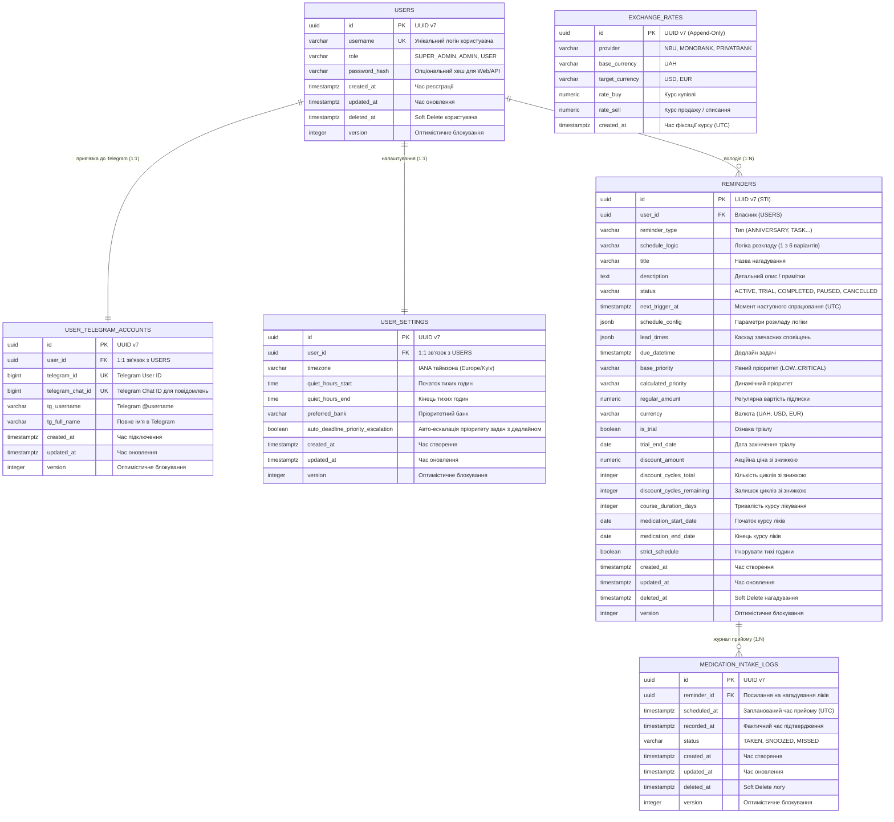

# Документація бази даних (PostgreSQL 16) — Reminder App

Даний документ містить вичерпний опис структури бази даних проекту **Reminder App**: загальну ER-діаграму, перелік типів даних та перелічень (ENUMs), детальний розбір кожної таблиці з типами колонок, обмеженнями, призначенням та реальними прикладами даних, а також готові DDL-скрипти створення схеми.

---

## 1. Загальні архітектурні принципи проектування БД

1. **СУБД та стандарти ідентифікаторів**:
   * **PostgreSQL 16**.
   * **Усі Primary Key (PK) суворо використовують UUID v7** (згідно з RFC 9562).
     * *Чому UUID v7 замість UUID v4?* UUID v7 містить 48-бітний Unix timestamp у мілісекундах на початку значення, завдяки чому є **природно монотонно зростаючим (time-ordered)**. Це повністю усуває проблему фрагментації сторінок B-Tree індексів у PostgreSQL, зберігаючи швидкість вставки на рівні класичних цілих чисел (`BIGINT`), але забезпечуючи глобальну унікальність без ризику колізій і витоку послідовностей при розподіленій архітектурі.
   * Усі часові мітки зберігаються виключно в **UTC** з часовим поясом (`TIMESTAMPTZ`), окрім локальних годин (тип `TIME` без таймзони) та календарних дат (тип `DATE`).
   * Грошові суми зберігаються в типі `NUMERIC(12, 2)` для запобігання втраті точності при роботі з курсами валют та дробовими копійками/центами.

2. **Декомпозиція сутностей користувача (Users / Telegram / Settings)**:
   * **`users`** — ядро ідентифікації (`id`, `username`, `role`, опціональний `password_hash` для майбутнього Web/API доступу). Таблиця повністю абстрагована від конкретного месенджера.
   * **`user_telegram_accounts`** — зв'язок 1:1 з `users`. Зберігає специфічні дані Telegram (`telegram_id`, `telegram_chat_id`, `tg_username`, `tg_full_name`). Дозволяє в майбутньому легко підключати нові канали зв'язку (Web, Discord, WhatsApp) без рефакторингу ядра. Акаунт або існує, або видаляється (без зайвих `deleted_at`).
   * **`user_settings`** — зв'язок 1:1 з `users`. Зберігає користувацькі конфігурації (`timezone`, `quiet_hours_start`, `quiet_hours_end`, `preferred_bank`, `auto_deadline_priority_escalation`). Налаштування завжди існують разом з користувачем (без `deleted_at`).

3. **Аудит, Soft Delete та Hard Delete**:
   * У системі чітко розмежовано два підходи до видалення:
     * **Soft Delete (м'яке видалення)**: реалізовано в таблицях нагадувань (`reminders`) та журналів (`medication_intake_logs`) через поле `deleted_at TIMESTAMPTZ NULL`. Використовується для приховування подій користувачем без порушення цілісності пов'язаних реляційних даних та для збереження історії.
     * **Hard Delete (фізичне видалення)**: прямий SQL `DELETE` з каскадним видаленням `ON DELETE CASCADE`. Використовується при повному видаленні облікового запису користувача (purge/GDPR) або безповоротному очищенні чернеток.
   * Таблиці `users`, `reminders` та `medication_intake_logs` підтримують `deleted_at`. Для жорстко пов'язаних таблиць `user_settings` та `user_telegram_accounts` це поле відсутнє, оскільки вони видаляються каскадно разом із користувачем.

4. **Оптимістичне блокування (Optimistic Concurrency Control)**:
   * Усі змінювані таблиці містять поле `version INTEGER NOT NULL DEFAULT 1`.
   * При кожному оновленні виконується перевірка `UPDATE ... SET version = version + 1 WHERE id = :id AND version = :expected_version`. Це гарантує захист від стану гонитви (Race Condition), коли користувач одночасно натискає кнопку в Telegram, а фоновий шедулер оновлює розклад або пріоритет нагадування.

5. **Append-Only журнал валютних курсів (`exchange_rates`)**:
   * Таблиця зберігає повну історію курсів без перезапису існуючих рядків.
   * Розрахункове навантаження (5 банків $\times$ 1 запит/добу = ~1800 рядків/рік) є мізерним для PostgreSQL, проте дає безцінну локальну історію динаміки курсів для аналітики та графіків.
   * Найновіший курс витягується через індекс за `created_at DESC LIMIT 1`.

6. **Патерн Single Table Inheritance (STI) для Нагадувань**:
   * Усі 5 типів нагадувань (`ANNIVERSARY`, `OPEN_TASK`, `DEADLINE_TASK`, `SUBSCRIPTION`, `MEDICATION`) зберігаються в **єдиній таблиці `reminders`**.
   * Таблиця позбавлена надлишкових текстових полів (`medication_name`, `dosage`, `billing_account`), оскільки вони повністю покриваються стандартними полями `title` та `description`.
   * Календарні параметри річниць (день, місяць, рік народження для розрахунку віку) зберігаються всередині `schedule_config` (JSONB), усуваючи дублювання колонок у таблиці.
   * Опитування шедулером записів відбувається блискавично через частковий композитний індекс:
     ```sql
     SELECT * FROM reminders 
     WHERE next_trigger_at <= NOW() 
       AND status IN ('ACTIVE', 'TRIAL') 
       AND deleted_at IS NULL 
     ORDER BY next_trigger_at ASC 
     LIMIT 100 
     FOR UPDATE SKIP LOCKED;
     ```

---

## 2. Загальна ER-діаграма бази даних



---

## 3. Перелічення (PostgreSQL ENUMs)

| Назва типу ENUM | Дозволені значення | Опис призначення |
| :--- | :--- | :--- |
| `user_role_enum` | `SUPER_ADMIN`<br>`ADMIN`<br>`USER` | Роль користувача в системі для контролю доступу (RBAC). |
| `reminder_type_enum` | `ANNIVERSARY`<br>`OPEN_TASK`<br>`DEADLINE_TASK`<br>`SUBSCRIPTION`<br>`MEDICATION` | Тип доменного агрегату нагадування. |
| `schedule_logic_type_enum` | `DATE_WITH_MONTH_INTERVAL`<br>`DAILY_AT_TIMES`<br>`EXACT_DATETIME_DEADLINE`<br>`EXACT_DATE_DEADLINE`<br>`INTERVAL_DAYS`<br>`INTERVAL_HOURS` | 6 фундаментальних логік обчислення розкладу. |
| `reminder_status_enum` | `ACTIVE`<br>`TRIAL`<br>`COMPLETED`<br>`PAUSED`<br>`CANCELLED` | Життєвий цикл нагадування. |
| `priority_enum` | `LOW`<br>`MEDIUM`<br>`HIGH`<br>`CRITICAL` | Рівні терміновості задач. |
| `exchange_rate_provider_enum` | `NBU`<br>`MONOBANK`<br>`PRIVATBANK` | Джерело курсів валют. |
| `end_of_month_policy_enum` | `LAST_DAY_OF_MONTH`<br>`FIRST_DAY_OF_NEXT_MONTH` | Політика корекції дати 29-31 чисел у коротких місяцях. |
| `medication_log_status_enum`| `TAKEN`<br>`SNOOZED`<br>`MISSED` | Статус прийому в журналі ліків. |

---

## 4. Детальний опис таблиць

### 4.1. Таблиця `users` (Ядро ідентифікації користувачів)

**Призначення**: Зберігає базовий обліковий запис системи. Повністю ізольована від специфіки месенджерів (Telegram, Discord тощо), що забезпечує чисту доменну модель та можливість підключення веб-панелі керування.

#### Поля таблиці:

| Назва поля | Тип даних | Обмеження | Приклад | Пояснення призначення поля |
| :--- | :--- | :--- | :--- | :--- |
| `id` | `UUID` | `PRIMARY KEY` (UUID v7) | `018f4a22-38b4-7123-89ab-cdef01234567` | Унікальний сурогатний ідентифікатор користувача (UUID v7). Впорядкований за часом. |
| `username` | `VARCHAR(255)` | `NOT NULL`, `UNIQUE` | `'alex_dev'` | Унікальний системний логін користувача. При реєстрації через Telegram копіює його `tg_username` (або `tg_id` у разі відсутності нікнейма в Telegram). Забезпечує майбутній вхід у веб-панель/API. |
| `role` | `user_role_enum` | `NOT NULL`, `DEFAULT 'USER'` | `'USER'` | Рівень доступу: `SUPER_ADMIN`, `ADMIN`, `USER`. |
| `password_hash` | `VARCHAR(255)` | `NULL` | `'$2b$12$e8x...hash'` | Хеш пароля для веб-панелі чи API. Для бот-користувачів — `NULL`. |
| `created_at` | `TIMESTAMPTZ` | `NOT NULL`, `DEFAULT NOW()` | `2026-11-01 10:00:00+00` | Дата та час реєстрації облікового запису (UTC). |
| `updated_at` | `TIMESTAMPTZ` | `NOT NULL`, `DEFAULT NOW()` | `2026-11-01 10:00:00+00` | Дата та час останнього оновлення даних (UTC). |
| `deleted_at` | `TIMESTAMPTZ` | `NULL` | `NULL` | Час м'якого видалення акаунта. Якщо `NULL` — користувач активний. |
| `version` | `INTEGER` | `NOT NULL`, `DEFAULT 1` | `1` | Лічильник версії запису для оптимістичного блокування. |

---

### 4.2. Таблиця `user_telegram_accounts` (Прив'язка до Telegram, 1:1)

**Призначення**: Зберігає метадані взаємодії користувача з платформою Telegram. Зв'язок 1:1 з таблицею `users`. Дозволяє системі надсилати push-сповіщення, підтримувати сесії бота та ідентифікувати користувача за вхідними подіями Long Polling. Не містить `deleted_at`: акаунт або існує, або видаляється каскадно разом з користувачем (чи відв'язується через фізичний `DELETE`).

#### Поля таблиці:

| Назва поля | Тип даних | Обмеження | Приклад | Пояснення призначення поля |
| :--- | :--- | :--- | :--- | :--- |
| `id` | `UUID` | `PRIMARY KEY` (UUID v7) | `018f4a22-41a0-7abc-9111-cdef01234568` | Первинний ключ запису прив'язки Telegram (UUID v7). |
| `user_id` | `UUID` | `NOT NULL`, `UNIQUE`, `REFERENCES users(id) ON DELETE CASCADE` | `018f4a22-38b4-7123-89ab-cdef01234567` | Зовнішній ключ до головного облікового запису користувача. Забезпечує зв'язок 1:1. |
| `telegram_id` | `BIGINT` | `NOT NULL`, `UNIQUE` | `382910481` | Унікальний цифровий ідентифікатор користувача в платформі Telegram (`from_user.id`). |
| `telegram_chat_id` | `BIGINT` | `NOT NULL`, `UNIQUE` | `382910481` | Ідентифікатор чату діалогу з ботом для надсилання повідомлень через `send_message`. |
| `tg_username` | `VARCHAR(255)` | `NULL` | `'alex_dev'` | Публічний нікнейм у Telegram (без символу `@`). Оновлюється ботом при зміні. |
| `tg_full_name` | `VARCHAR(255)` | `NULL` | `'Олександр Пастух'` | Відображуване повне ім'я користувача (First Name + Last Name). |
| `created_at` | `TIMESTAMPTZ` | `NOT NULL`, `DEFAULT NOW()` | `2026-11-01 10:00:00+00` | Дата підключення бота Telegram (UTC). |
| `updated_at` | `TIMESTAMPTZ` | `NOT NULL`, `DEFAULT NOW()` | `2026-11-02 11:15:00+00` | Дата останнього оновлення профілю (UTC). |
| `version` | `INTEGER` | `NOT NULL`, `DEFAULT 1` | `1` | Лічильник версії запису для оптимістичного блокування. |

---

### 4.3. Таблиця `user_settings` (Індивідуальні налаштування користувача, 1:1)

**Призначення**: Зберігає конфігурації поведінки системи під конкретного користувача: часовий пояс, параметри "Тихих годин", банк для курсів валют та автоматичну ескалацію пріоритету задач. Зв'язок 1:1 з `users`. Не містить `deleted_at`: налаштування завжди існують, доки існує користувач.

#### Поля таблиці:

| Назва поля | Тип даних | Обмеження | Приклад | Пояснення призначення поля |
| :--- | :--- | :--- | :--- | :--- |
| `id` | `UUID` | `PRIMARY KEY` (UUID v7) | `018f4a22-49c5-7f12-8822-cdef01234569` | Первинний ключ запису налаштувань (UUID v7). |
| `user_id` | `UUID` | `NOT NULL`, `UNIQUE`, `REFERENCES users(id) ON DELETE CASCADE` | `018f4a22-38b4-7123-89ab-cdef01234567` | Зовнішній ключ 1:1 до таблиці `users`. |
| `timezone` | `VARCHAR(64)` | `NOT NULL`, `DEFAULT 'Europe/Kyiv'` | `'Europe/Kyiv'` | IANA-ідентифікатор часового поясу користувача для розрахунку локального часу і тихих годин. |
| `quiet_hours_start` | `TIME` | `NOT NULL`, `DEFAULT '23:00:00'` | `23:00:00` | Початок нічного періоду тиші в локальному часі користувача. |
| `quiet_hours_end` | `TIME` | `NOT NULL`, `DEFAULT '08:00:00'` | `08:00:00` | Завершення тихих годин (під час тихих годин звичайні сповіщення надсилаються без звуку). |
| `preferred_bank` | `exchange_rate_provider_enum` | `NOT NULL`, `DEFAULT 'MONOBANK'` | `'MONOBANK'` | Обраний банк для конвертації валютних підписок. Якщо оновлення банку старіше за 48 год — fallback на НБУ. |
| `auto_deadline_priority_escalation` | `BOOLEAN` | `NOT NULL`, `DEFAULT TRUE` | `TRUE` | **Автоматична ескалація пріоритету задач з дедлайном**. Якщо `TRUE`, і користувач не вказав пріоритет вручну, система динамічно підвищує пріоритет (`LOW` $\rightarrow$ `CRITICAL`) при наближенні дедлайну. |
| `created_at` | `TIMESTAMPTZ` | `NOT NULL`, `DEFAULT NOW()` | `2026-11-01 10:00:00+00` | Дата створення налаштувань (UTC). |
| `updated_at` | `TIMESTAMPTZ` | `NOT NULL`, `DEFAULT NOW()` | `2026-11-02 08:00:00+00` | Дата оновлення налаштувань (UTC). |
| `version` | `INTEGER` | `NOT NULL`, `DEFAULT 1` | `1` | Оптимістичне блокування. |

---

### 4.4. Таблиця `reminders` (Single Table Inheritance)

**Призначення**: Консолідована таблиця для зберігання всіх типів нагадувань (`ANNIVERSARY`, `OPEN_TASK`, `DEADLINE_TASK`, `SUBSCRIPTION`, `MEDICATION`). Очищена від надлишкових текстових полів (`medication_name`, `dosage`, `billing_account`), які зберігаються в `title` та `description`. Календарні параметри річниць знаходяться у `schedule_config`.

#### 4.4.1. Базові та спільні колонки

| Назва поля | Тип даних | Обмеження | Приклад | Пояснення призначення поля |
| :--- | :--- | :--- | :--- | :--- |
| `id` | `UUID` | `PRIMARY KEY` (UUID v7) | `018f4a25-88ff-7421-99ee-cdef01234570` | Унікальний ідентифікатор нагадування (UUID v7). Впорядкований за часом. |
| `user_id` | `UUID` | `NOT NULL`, `REFERENCES users(id) ON DELETE CASCADE` | `018f4a22-38b4-7123-89ab-cdef01234567` | Власник нагадування. |
| `reminder_type` | `reminder_type_enum` | `NOT NULL` | `'SUBSCRIPTION'` | Дискримінатор типу нагадування (`ANNIVERSARY`, `OPEN_TASK`, `DEADLINE_TASK`, `SUBSCRIPTION`, `MEDICATION`). |
| `schedule_logic` | `schedule_logic_type_enum`| `NOT NULL` | `'DATE_WITH_MONTH_INTERVAL'` | Дискримінатор 1 з 6 логік планування розкладу. |
| `title` | `VARCHAR(255)` | `NOT NULL` | `'Spotify Family'` або `'Амоксиклав 500 мг (1 таб.)'` | Заголовок нагадування: назва підписки, ім'я іменинника, назва ліків із дозуванням або заголовок задачі. |
| `description` | `TEXT` | `NULL` | `'Оплата з чорної картки Моно'` | Додаткові нотатки користувача (рахунок списання, примітки до задачі або інструкції до ліків). |
| `status` | `reminder_status_enum` | `NOT NULL`, `DEFAULT 'ACTIVE'` | `'ACTIVE'` | Поточний статус: `ACTIVE`, `TRIAL`, `COMPLETED`, `PAUSED`, `CANCELLED`. |
| `next_trigger_at` | `TIMESTAMPTZ` | `NOT NULL` | `2026-11-15 07:00:00+00` | **Ключове поле шедулера**. Точний найближчий момент відправки наступного повідомлення (UTC). |
| `schedule_config` | `JSONB` | `NOT NULL` | `{"type": "month_interval", "day": 15, "interval_months": 1}` | Специфічні параметри розкладу для обраної `schedule_logic` (години прийому ліків, інтервали днів, день/місяць річниці та рік народження). |
| `lead_times` | `JSONB` | `NOT NULL`, `DEFAULT '[]'::jsonb`| `["5d", "3d", "1d"]` | Каскад відносних зміщень завчасного сповіщення. |
| `created_at` | `TIMESTAMPTZ` | `NOT NULL`, `DEFAULT NOW()` | `2026-11-01 12:00:00+00` | Дата створення нагадування (UTC). |
| `updated_at` | `TIMESTAMPTZ` | `NOT NULL`, `DEFAULT NOW()` | `2026-11-02 08:30:00+00` | Дата останньої модифікації запису (UTC). |
| `deleted_at` | `TIMESTAMPTZ` | `NULL` | `NULL` | Час м'якого видалення. Не-NULL виключає подію з шедулера. |
| `version` | `INTEGER` | `NOT NULL`, `DEFAULT 1` | `1` | Версія оптимістичного блокування при оновленні статусу чи розкладу. |

#### 4.4.2. Специфічні колонки для Задач (`OPEN_TASK`, `DEADLINE_TASK`)

| Назва поля | Тип даних | Обмеження | Приклад | Пояснення призначення поля |
| :--- | :--- | :--- | :--- | :--- |
| `due_datetime` | `TIMESTAMPTZ` | `NULL` | `2026-11-20 18:00:00+00` | Чіткий дедлайн задачі. Для `OPEN_TASK` завжди `NULL`. |
| `base_priority` | `priority_enum` | `NULL` | `'HIGH'` | Встановлений користувачем пріоритет. Якщо `NULL` — діє як `UNSET`. |
| `calculated_priority` | `priority_enum` | `NULL` | `'CRITICAL'` | Поточний динамічний пріоритет, обчислений автоматично формулою залишку часу. |

#### 4.4.3. Специфічні колонки для Підписок та Платежів (`SUBSCRIPTION`)

| Назва поля | Тип даних | Обмеження | Приклад | Пояснення призначення поля |
| :--- | :--- | :--- | :--- | :--- |
| `regular_amount` | `NUMERIC(12, 2)` | `NULL` | `14.99` | Базова регулярна ціна підписки після завершення знижки або тріалу. |
| `currency` | `VARCHAR(3)` | `NULL`, `DEFAULT 'UAH'` | `'USD'` | Валюта підписки (`UAH`, `USD`, `EUR`). |
| `is_trial` | `BOOLEAN` | `NOT NULL`, `DEFAULT FALSE` | `TRUE` | Ознака безкоштовного пробного періоду. |
| `trial_end_date` | `DATE` | `NULL` | `2026-11-15` | Дата завершення пробного періоду. Після цієї дати діє `regular_amount` (або `discount_amount`, якщо задано знижку). |
| `discount_amount` | `NUMERIC(12, 2)` | `NULL` | `1.99` | Знижена акційна вартість за платіжний цикл. |
| `discount_cycles_total`| `INTEGER` | `NULL` | `3` | Загальна кількість акційних платежів зі знижкою. |
| `discount_cycles_remaining`| `INTEGER`| `NULL` | `2` | Залишок акційних циклів (зменшується на 1 після кожної оплати). |

#### 4.4.4. Специфічні колонки для Ліків (`MEDICATION`)

| Назва поля | Тип даних | Обмеження | Приклад | Пояснення призначення поля |
| :--- | :--- | :--- | :--- | :--- |
| `course_duration_days`| `INTEGER` | `NULL` | `10` | Тривалість курсу в днях. Якщо курс безстроковий/пожиттєвий (вітаміни, хронічні ліки) — значення `NULL`. |
| `medication_start_date`| `DATE` | `NULL` | `2026-11-02` | Дата старту курсу ліків (опціонально; `NULL` для безстрокового прийому). |
| `medication_end_date` | `DATE` | `NULL` | `2026-11-12` | Дата завершення курсу ліків (`start_date + course_duration_days`). Якщо курс пожиттєвий/безстроковий — суворо `NULL`. |
| `strict_schedule` | `BOOLEAN` | `NOT NULL`, `DEFAULT FALSE` | `TRUE` | **Критичний прапорець**: якщо `TRUE`, сповіщення ігнорує тихі години (відправляється вночі). |

---

### 4.5. Таблиця `medication_intake_logs` (Журнал прийому ліків)

**Призначення**: Забезпечує ведення журналу дотримання лікування (adherence log), фіксує відповіді на інлайн-кнопки в Telegram (`[💊 Прийняв]`, `[⏰ +15 хв]`, `[❌ Пропустив]`), підтримує soft-delete та оптимістичне блокування.

#### Поля таблиці:

| Назва поля | Тип даних | Обмеження | Приклад | Пояснення призначення поля |
| :--- | :--- | :--- | :--- | :--- |
| `id` | `UUID` | `PRIMARY KEY` (UUID v7) | `018f4a27-0101-7111-9222-cdef01234571` | Первинний ключ запису журналу (UUID v7). |
| `reminder_id` | `UUID` | `NOT NULL`, `REFERENCES reminders(id) ON DELETE CASCADE` | `018f4a25-88ff-7421-99ee-cdef01234570` | Посилання на нагадування ліків. |
| `scheduled_at` | `TIMESTAMPTZ` | `NOT NULL` | `2026-11-02 16:00:00+00` | Плановий час прийому за графіком (UTC). |
| `recorded_at` | `TIMESTAMPTZ` | `NULL` | `2026-11-02 16:04:12+00` | Фактичний час натискання кнопки користувачем (UTC). |
| `status` | `medication_log_status_enum`| `NOT NULL`, `DEFAULT 'MISSED'` | `'TAKEN'` | Результат: `'TAKEN'`, `'SNOOZED'`, `'MISSED'`. |
| `created_at` | `TIMESTAMPTZ` | `NOT NULL`, `DEFAULT NOW()` | `2026-11-02 16:00:00+00` | Час створення запису журналу (UTC). |
| `updated_at` | `TIMESTAMPTZ` | `NOT NULL`, `DEFAULT NOW()` | `2026-11-02 16:04:12+00` | Час оновлення запису (UTC). |
| `deleted_at` | `TIMESTAMPTZ` | `NULL` | `NULL` | Soft delete мітка. |
| `version` | `INTEGER` | `NOT NULL`, `DEFAULT 1` | `1` | Версія оптимістичного блокування. |

#### Індекси:
* `idx_medication_logs_reminder_scheduled` (`btree (reminder_id, scheduled_at DESC) WHERE deleted_at IS NULL`).

---

### 4.6. Таблиця `exchange_rates` (Append-Only історія курсів валют)

**Призначення**: Незмінний (Immutable / Append-Only) часовий ряд отриманих валютних курсів від НБУ, Monobank, ПриватБанку. Нові дані завжди додаються через `INSERT`, що дозволяє відстежувати графіки зміни курсу, проводити історичний аналіз витрат на підписки та перевіряти свіжість курсів (>48 годин).

#### Поля таблиці:

| Назва поля | Тип даних | Обмеження | Приклад | Пояснення призначення поля |
| :--- | :--- | :--- | :--- | :--- |
| `id` | `UUID` | `PRIMARY KEY` (UUID v7) | `018f4a29-aaaa-7999-b111-cdef01234572` | Первинний ключ знімку курсу (UUID v7). Завдяки v7 природно сортується за часом запису. |
| `provider` | `exchange_rate_provider_enum` | `NOT NULL` | `'MONOBANK'` | Джерело курсу (`NBU`, `MONOBANK`, `PRIVATBANK`). |
| `base_currency` | `VARCHAR(3)` | `NOT NULL`, `DEFAULT 'UAH'` | `'UAH'` | Базова валюта (гривня `UAH`). |
| `target_currency`| `VARCHAR(3)` | `NOT NULL` | `'USD'` | Код іноземної валюти (`USD`, `EUR`). |
| `rate_buy` | `NUMERIC(10, 4)` | `NULL` | `41.2000` | Курс купівлі банком. Для НБУ дорівнює курсу продажу. |
| `rate_sell` | `NUMERIC(10, 4)` | `NOT NULL` | `41.7500` | Курс продажу / списання за карткою для оплати підписки. |
| `created_at` | `TIMESTAMPTZ` | `NOT NULL`, `DEFAULT NOW()` | `2026-11-02 09:00:00+00` | Точний час отримання та фіксації курсу в базі (UTC). За цим полем визначається свіжість. |

#### Індекси:
* `idx_exchange_rates_provider_currency_created` (`btree (provider, target_currency, created_at DESC)`) — дозволяє миттєво знаходити найсвіжіший курс банку або будувати графік за діапазон дат.

---

## 5. Специфікація та приклади даних для `schedule_config` та `lead_times` (Усі 8 допустимих комбінацій)

Згідно з матрицею відповідності домену, у системі дозволено рівно **8 комбінацій** типу нагадування (`reminder_type`) та логіки планування (`schedule_logic`). Нижче наведено точні структури JSONB-об'єктів для кожної з них:

### 1. `ANNIVERSARY` + `DATE_WITH_MONTH_INTERVAL` (Логіка 1)
* **Призначення**: Дні народження, річниці весілля, щорічні пам'ятні дати.
* **`schedule_config`**:
  ```json
  {
    "day": 29,
    "month": 2,
    "interval_months": 12,
    "birth_year": 1996,
    "end_of_month_policy": "last_day_of_month"
  }
  ```
* **`lead_times`**:
  ```json
  ["14d", "7d", "3d", "1d", "0d"]
  ```
* **Як працює**: `lead_times` визначає каскад завчасних сповіщень. Спочатку `next_trigger_at` ставиться на подію мінус 14 днів о 09:00. Після відправки зсувається на "7d", "3d", "1d" і в день події "0d". Після настання події дата в `schedule_config` зсувається на наступний рік (+12 місяців), а `birth_year` дозволяє боту привітати: *«Олександру виповнюється 31 рік»*. Політика `last_day_of_month` у невисокосний рік автоматично зміщує 29 лютого на 28 лютого.

---

### 2. `OPEN_TASK` + `DAILY_AT_TIMES` (Логіка 2)
* **Призначення**: Задачі без жорсткого дедлайну для регулярних ранкових чи вечірніх дайджестів.
* **`schedule_config`**:
  ```json
  {
    "times": ["09:00"]
  }
  ```
  *(або `{"times": ["09:00", "20:00"]}` для нагадування двічі на добу)*
* **`lead_times`**:
  ```json
  []
  ```
* **Як працює**: Для відкритих задач `lead_times` завжди порожній `[]` (немає дедлайну, до якого треба завчасно попереджати). Задача потрапляє у щоденний дайджест о зазначеній годині у часовому поясі користувача.

---

### 3. `DEADLINE_TASK` + `EXACT_DATETIME_DEADLINE` (Логіка 3)
* **Призначення**: Термінова задача з чітким дедлайном до конкретної дати та години (наприклад, подати звіт до 15.11.2026 18:00).
* **`schedule_config`**:
  ```json
  {
    "due_datetime": "2026-11-15T18:00:00Z"
  }
  ```
* **`lead_times`**:
  ```json
  ["3d", "1d", "2h", "0d"]
  ```
* **Як працює**: `next_trigger_at` обчислюється відніманням поточного кроку `lead_times` від `due_datetime` (за 3 дні, за добу, за 2 години і рівно о 18:00). Якщо дедлайн минув, а статус ще не `COMPLETED` — переходить у режим щоденного сповіщення про прострочення.

---

### 4. `DEADLINE_TASK` + `EXACT_DATE_DEADLINE` (Логіка 4)
* **Призначення**: Задача з дедлайном на конкретний календарний день без зазначення години (наприклад, сплатити податок до 20 листопада).
* **`schedule_config`**:
  ```json
  {
    "due_date": "2026-11-20",
    "default_notify_time": "09:00"
  }
  ```
* **`lead_times`**:
  ```json
  ["7d", "3d", "1d", "0d"]
  ```
* **Як працює**: Сповіщення надсилаються о 09:00 ранку (за місцевим часом) за 7, 3, 1 день та в день дедлайну ("0d").

---

### 5. `SUBSCRIPTION` + `DATE_WITH_MONTH_INTERVAL` (Логіка 1)
* **Призначення**: Щомісячні або щорічні регулярні підписки на фіксоване число місяця (Spotify, iCloud, оренда квартири).
* **`schedule_config`**:
  ```json
  {
    "day": 31,
    "interval_months": 1,
    "end_of_month_policy": "last_day_of_month"
  }
  ```
* **`lead_times`**:
  * *Звичайна підписка*:
    ```json
    ["3d", "1d", "0d"]
    ```
  * *Підписка у пробному періоді (тріал)*:
    ```json
    ["5d", "3d", "1d"]
    ```
* **Як працює**: При звичайній підписці попереджає за 3 дні, за 1 день і в день оплати. Якщо активний тріал (`is_trial = true`), відлік ведеться від `trial_end_date` з попередженням: *«Через 3 дні закінчується тріал і буде списано $9.99»*. При `last_day_of_month` платіж 31-го числа в лютому переноситься на 28/29 число.

---

### 6. `SUBSCRIPTION` + `INTERVAL_DAYS` (Логіка 5)
* **Призначення**: Підписки з кастомним циклом у днях (тарифи операторів на 28 днів, заміна картриджів фільтра кожні 90 днів).
* **`schedule_config`**:
  ```json
  {
    "days": 28,
    "notify_time": "09:00"
  }
  ```
* **`lead_times`**:
  ```json
  ["2d", "1d", "0d"]
  ```
* **Як працює**: `next_trigger_at` розраховується з урахуванням зсувів перед кожним 28-денним циклом (за 2 дні, за день і в день списання).

---

### 7. `MEDICATION` + `DAILY_AT_TIMES` (Логіка 2)
* **Призначення**: Прийом вітамінів або щоденних препаратів у фіксовані години. Може бути курсовим (наприклад, 10 днів) або **пожиттєвим/безстроковим** (`course_duration_days = null`, `medication_end_date = null`).
* **`schedule_config`**:
  ```json
  {
    "times": ["08:00", "14:00", "20:00"]
  }
  ```
* **`lead_times`**:
  ```json
  []
  ```
* **Як працює**: `lead_times` завжди `[]` (ліки не потребують попереджень "за 3 дні", сповіщення надсилається рівно у зазначений час). Після прийому о 08:00 `next_trigger_at` автоматично ставиться на 14:00, потім на 20:00, а далі на 08:00 наступного дня. Якщо `strict_schedule = true`, сповіщення надходить без перенесення на ранок навіть у тихі години.

---

### 8. `MEDICATION` + `INTERVAL_HOURS` (Логіка 6)
* **Призначення**: Суворий прийом ліків через рівні проміжки часу (наприклад, антибіотики кожні 8 годин, знеболювальні кожні 6 годин). Може бути як курсовим, так і безстроковим.
* **`schedule_config`**:
  ```json
  {
    "interval_hours": 8,
    "first_trigger": "08:00"
  }
  ```
* **`lead_times`**:
  ```json
  []
  ```
* **Як працює**: `lead_times` завжди `[]`. Кожне наступне спрацювання шедулера: `next_trigger_at = previous_trigger_at + 8 hours`. Завдяки `strict_schedule = true` нічний прийом о 02:00 надсилається вчасно, рятуючи пацієнта від порушення концентрації антибіотика в крові.

---

### 5.1. Принцип роботи шедулера з `lead_times` (Чому в БД не зберігається індекс?)

У базі даних **суворо заборонено зберігати числовий індекс поточного елемента** (наприклад, `current_lead_index`). Збереження індексу є вразливим патерном: при динамічному додаванні ("5d") чи видаленні користувачем елементів масиву індекси неминуче розсинхронізуються.

Натомість реалізовано **безстатусну часову проекцію (Time-Series Projection)**:
1. Кожна подія має Цільову Дату Події ($T_{\text{target}}$): дедлайн, дату закінчення тріалу чи черговий платіж підписки/річницю.
2. Масив `lead_times` парситься у часові зміщення від $T_{\text{target}}$:
   $$T_k = T_{\text{target}} - \text{offset}_k$$
3. Усі моменти впорядковуються хронологічно: $[T_0, T_1, \dots, T_n]$.
4. Наступним моментом спрацювання завжди обирається найближча майбутня точка:
   $$T_{\text{next}} = \min(\{T_k \mid T_k > T_{\text{current}}\})$$
5. Якщо користувач динамічно змінює масив `lead_times`, система наново генерує шкалу точок і бере найменшу точку, де $T_k > \text{NOW()}$.
6. Коли спрацьовує остання точка "0d", цільова дата циклічної події ($T_{\text{target}}$) зсувається на наступний місяць або рік, генеруючи новий каскад точок для наступного платіжного/календарного циклу.

---

## 6. DDL-скрипт створення схеми бази даних (PostgreSQL 16)

```sql
-- 1. Створення розширення pgcrypto
CREATE EXTENSION IF NOT EXISTS "pgcrypto";

-- 2. Допоміжна PL/pgSQL функція генерації UUID v7 у PostgreSQL 16 (RFC 9562)
CREATE OR REPLACE FUNCTION uuid_generate_v7() RETURNS UUID AS $$
DECLARE
    v_time DOUBLE PRECISION;
    v_epoch_ms BIGINT;
    v_bytes BYTEA;
BEGIN
    v_time := clock_timestamp();
    v_epoch_ms := TRUNC(EXTRACT(EPOCH FROM v_time) * 1000)::BIGINT;
    
    v_bytes := SUBSTRING(int8send(v_epoch_ms) FROM 3 FOR 6) || gen_random_bytes(10);
    
    v_bytes := SET_BYTE(v_bytes, 6, (GET_BYTE(v_bytes, 6) & 15) | 112);
    v_bytes := SET_BYTE(v_bytes, 8, (GET_BYTE(v_bytes, 8) & 63) | 128);
    
    RETURN encode(v_bytes, 'hex')::UUID;
END;
$$ LANGUAGE plpgsql VOLATILE;

-- 3. Створення типів перелічень (ENUMs)
CREATE TYPE user_role_enum AS ENUM (
    'SUPER_ADMIN',
    'ADMIN',
    'USER'
);

CREATE TYPE reminder_type_enum AS ENUM (
    'ANNIVERSARY',
    'OPEN_TASK',
    'DEADLINE_TASK',
    'SUBSCRIPTION',
    'MEDICATION'
);

CREATE TYPE schedule_logic_type_enum AS ENUM (
    'DATE_WITH_MONTH_INTERVAL',
    'DAILY_AT_TIMES',
    'EXACT_DATETIME_DEADLINE',
    'EXACT_DATE_DEADLINE',
    'INTERVAL_DAYS',
    'INTERVAL_HOURS'
);

CREATE TYPE reminder_status_enum AS ENUM (
    'ACTIVE',
    'TRIAL',
    'COMPLETED',
    'PAUSED',
    'CANCELLED'
);

CREATE TYPE priority_enum AS ENUM (
    'LOW',
    'MEDIUM',
    'HIGH',
    'CRITICAL'
);

CREATE TYPE exchange_rate_provider_enum AS ENUM (
    'NBU',
    'MONOBANK',
    'PRIVATBANK'
);

CREATE TYPE end_of_month_policy_enum AS ENUM (
    'LAST_DAY_OF_MONTH',
    'FIRST_DAY_OF_NEXT_MONTH'
);

CREATE TYPE medication_log_status_enum AS ENUM (
    'TAKEN',
    'SNOOZED',
    'MISSED'
);

-- 4. Таблиця USERS (Головні облікові записи)
CREATE TABLE users (
    id UUID PRIMARY KEY DEFAULT uuid_generate_v7(),
    username VARCHAR(255) NOT NULL UNIQUE,
    role user_role_enum NOT NULL DEFAULT 'USER',
    password_hash VARCHAR(255),
    created_at TIMESTAMPTZ NOT NULL DEFAULT NOW(),
    updated_at TIMESTAMPTZ NOT NULL DEFAULT NOW(),
    deleted_at TIMESTAMPTZ,
    version INTEGER NOT NULL DEFAULT 1
);

-- 5. Таблиця USER_TELEGRAM_ACCOUNTS (Прив'язка до Telegram, 1:1)
CREATE TABLE user_telegram_accounts (
    id UUID PRIMARY KEY DEFAULT uuid_generate_v7(),
    user_id UUID NOT NULL UNIQUE REFERENCES users(id) ON DELETE CASCADE,
    telegram_id BIGINT NOT NULL UNIQUE,
    telegram_chat_id BIGINT NOT NULL UNIQUE,
    tg_username VARCHAR(255),
    tg_full_name VARCHAR(255),
    created_at TIMESTAMPTZ NOT NULL DEFAULT NOW(),
    updated_at TIMESTAMPTZ NOT NULL DEFAULT NOW(),
    version INTEGER NOT NULL DEFAULT 1
);

-- 6. Таблиця USER_SETTINGS (Індивідуальні налаштування, 1:1)
CREATE TABLE user_settings (
    id UUID PRIMARY KEY DEFAULT uuid_generate_v7(),
    user_id UUID NOT NULL UNIQUE REFERENCES users(id) ON DELETE CASCADE,
    timezone VARCHAR(64) NOT NULL DEFAULT 'Europe/Kyiv',
    quiet_hours_start TIME NOT NULL DEFAULT '23:00:00',
    quiet_hours_end TIME NOT NULL DEFAULT '08:00:00',
    preferred_bank exchange_rate_provider_enum NOT NULL DEFAULT 'MONOBANK',
    auto_deadline_priority_escalation BOOLEAN NOT NULL DEFAULT TRUE,
    created_at TIMESTAMPTZ NOT NULL DEFAULT NOW(),
    updated_at TIMESTAMPTZ NOT NULL DEFAULT NOW(),
    version INTEGER NOT NULL DEFAULT 1
);

-- 7. Таблиця REMINDERS (Single Table Inheritance)
CREATE TABLE reminders (
    -- Базові спільні поля
    id UUID PRIMARY KEY DEFAULT uuid_generate_v7(),
    user_id UUID NOT NULL REFERENCES users(id) ON DELETE CASCADE,
    reminder_type reminder_type_enum NOT NULL,
    schedule_logic schedule_logic_type_enum NOT NULL,
    title VARCHAR(255) NOT NULL,
    description TEXT,
    status reminder_status_enum NOT NULL DEFAULT 'ACTIVE',
    next_trigger_at TIMESTAMPTZ NOT NULL,
    schedule_config JSONB NOT NULL,
    lead_times JSONB NOT NULL DEFAULT '[]'::jsonb,
    created_at TIMESTAMPTZ NOT NULL DEFAULT NOW(),
    updated_at TIMESTAMPTZ NOT NULL DEFAULT NOW(),
    deleted_at TIMESTAMPTZ,
    version INTEGER NOT NULL DEFAULT 1,

    -- Специфічні поля: Задачі
    due_datetime TIMESTAMPTZ,
    base_priority priority_enum,
    calculated_priority priority_enum,

    -- Специфічні поля: Підписки (Фінанси, Тріали, Знижки)
    regular_amount NUMERIC(12, 2) CHECK (regular_amount >= 0),
    currency VARCHAR(3) DEFAULT 'UAH',
    is_trial BOOLEAN NOT NULL DEFAULT FALSE,
    trial_end_date DATE,
    discount_amount NUMERIC(12, 2) CHECK (discount_amount >= 0),
    discount_cycles_total INTEGER CHECK (discount_cycles_total > 0),
    discount_cycles_remaining INTEGER CHECK (discount_cycles_remaining >= 0),

    -- Специфічні поля: Ліки
    course_duration_days INTEGER CHECK (course_duration_days > 0),
    medication_start_date DATE,
    medication_end_date DATE,
    strict_schedule BOOLEAN NOT NULL DEFAULT FALSE
);

-- Головний індекс шедулера для щохвилинного Cron-полера (SKIP LOCKED)
CREATE INDEX idx_reminders_scheduler ON reminders (next_trigger_at, status) 
WHERE status IN ('ACTIVE', 'TRIAL') AND deleted_at IS NULL;

-- Індекс вибірки нагадувань користувача за типом
CREATE INDEX idx_reminders_user_type ON reminders (user_id, reminder_type) 
WHERE deleted_at IS NULL;

-- 8. Таблиця MEDICATION_INTAKE_LOGS (Журнал прийому ліків)
CREATE TABLE medication_intake_logs (
    id UUID PRIMARY KEY DEFAULT uuid_generate_v7(),
    reminder_id UUID NOT NULL REFERENCES reminders(id) ON DELETE CASCADE,
    scheduled_at TIMESTAMPTZ NOT NULL,
    recorded_at TIMESTAMPTZ,
    status medication_log_status_enum NOT NULL DEFAULT 'MISSED',
    created_at TIMESTAMPTZ NOT NULL DEFAULT NOW(),
    updated_at TIMESTAMPTZ NOT NULL DEFAULT NOW(),
    deleted_at TIMESTAMPTZ,
    version INTEGER NOT NULL DEFAULT 1
);

CREATE INDEX idx_medication_logs_reminder_scheduled 
ON medication_intake_logs (reminder_id, scheduled_at DESC) 
WHERE deleted_at IS NULL;

-- 9. Таблиця EXCHANGE_RATES (Append-Only історія курсів валют)
CREATE TABLE exchange_rates (
    id UUID PRIMARY KEY DEFAULT uuid_generate_v7(),
    provider exchange_rate_provider_enum NOT NULL,
    base_currency VARCHAR(3) NOT NULL DEFAULT 'UAH',
    target_currency VARCHAR(3) NOT NULL,
    rate_buy NUMERIC(10, 4),
    rate_sell NUMERIC(10, 4) NOT NULL,
    created_at TIMESTAMPTZ NOT NULL DEFAULT NOW()
);

-- Індекс для миттєвого пошуку найновішого курсу банку та ретроспективної аналітики
CREATE INDEX idx_exchange_rates_provider_currency_created 
ON exchange_rates (provider, target_currency, created_at DESC);
```

---

## 7. Резюме архітектурних переваг оновленої схеми

1. **UUID v7**:
   * Знижує навантаження на підсистему пам'яті та диска PostgreSQL завдяки збереженню послідовності часових зрізів (time-ordered B-tree insertion).
2. **Модульна ізоляція платформи сповіщень**:
   * Відокремлення Telegram у `user_telegram_accounts` захищає бізнес-логіку користувачів від змін протоколу месенджера та дозволяє легко додати веб-кабінет або інші месенджери без зміни структури `users`.
3. **Чистота та лаконічність таблиці `reminders`**:
   * Видалено надлишкові колонки (`medication_name`, `dosage`, `billing_account`, `meal_relation`, `first_charge_amount`, `anniversary_*`), що спростило структуру таблиці на 40%, перенісши конфігурації у гнучкий `schedule_config` (JSONB) та універсальні поля `title` й `description`.
4. **Гнучкість Soft Delete та Hard Delete**:
   * Дозволяє приховувати сутності з пов'язаними даними (`deleted_at`), не руйнуючи цілісність реляційних зв'язків та історію, але зберігає можливість фізичного видалення (`DELETE ... ON DELETE CASCADE`) для повного очищення даних користувача.
5. **Захист від стану гонитви (OCC)**:
   * Поле `version` захищає дані від конфліктів між фоновими cron-процесами та діями користувача.
6. **Append-Only історія фінансів**:
   * Зберігає повну ретроспективу курсів валют без помітного впливу на обсяг дискового простору.
