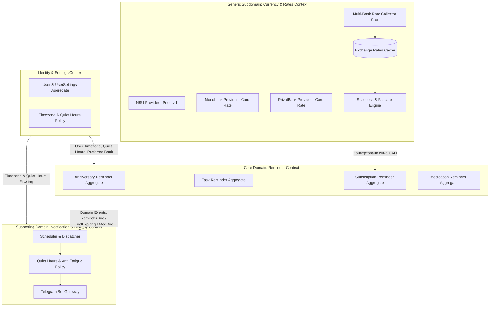

# Технічна специфікація та DDD-модель: Сервіс персональних нагадувань (Reminder App)

## 1. Загальний огляд (Overview)

Мета проєкту — створення автономного self-hosted сервісу персональних нагадувань із мультикористувацькою архітектурою (multi-user ready), гнучким плануванням кастомних інтервалів, ескалацією пріоритетів, обліком підписок (включно з тріалами та мультивалютністю з кількома банками), медичними курсами ліків та інтеграцією через Telegram Bot (Long Polling у закритій мережі).

---

## 2. Стратегічний DDD: Bounded Contexts (Обмежені контексти)



### 2.1. Identity & User Settings Context
Відповідає за декомпонований профіль користувача (`users`, `user_telegram_accounts`, `user_settings`), його часовий пояс (IANA Timezone, наприклад `Europe/Kyiv`), вікно тихих годин (`QuietHoursWindow`), налаштування `auto_deadline_priority_escalation` та обраний банк для курсів валют (`preferred_bank`). Усі агрегати системи мають строгу ізоляцію за `user_id`.

### 2.2. Reminder Management Context (Основний домен)
Керує життєвим циклом усіх нагадувань:
* **Anniversary**: щорічні події з каскадними нагадуваннями.
* **Task**: відкриті беклог-справи (дайджести) або задачі з дедлайном і динамічною ескалацією пріоритету.
* **Subscription**: регулярні фінансові списання, підтримка **безкоштовних/пробних періодів (Trial)** та автопереходу в регулярну підписку.
* **Medication**: курси прийому ліків із фіксованими годинами чи суворими інтервалами та журналом обліку прийому.

### 2.3. Currency & Exchange Rate Context (Фінансовий контекст)
Щоденний збір курсів валют (НБУ, Monobank, ПриватБанк), збереження в локальну БД, підтримка карткових курсів списання.
* Реалізує політику безпечного фолбеку: якщо обраний банк користувача не оновлював курс понад 48 годин, автоматично застосовується офіційний курс НБУ з відповідним повідомленням.

### 2.4. Notification & Delivery Context (Комунікаційний контекст)
Черга сповіщень у Redis, перевірка `QuietHours` із підтримкою винятку `strict_schedule` (для критичних ліків), розсилка через Telegram та обробка інлайн-кнопок дій користувача.

---

## 3. Ubiquitous Language (Єдина термінологія / Глосарій)

* **User (Користувач)** — власник нагадувань. Усі сутності прив'язані до `user_id`.
* **Reminder (Нагадування)** — базова бізнес-сутність події або задачі.
* **Anniversary (Річниця / День народження)** — щорічна подія з каскадним графіком завчасних сповіщень.
* **Open Task (Відкрита задача)** — справа без жорсткого дедлайну для м'яких дайджестів.
* **Deadline Task (Термінова задача)** — задача з `due_date`, що підлягає автоескалації пріоритету.
* **Dynamic Priority (Динамічний пріоритет)** — розрахунковий рівень терміновості (Low $\rightarrow$ Medium $\rightarrow$ High $\rightarrow$ Critical).
* **Subscription (Підписка)** — регулярний платіж із сумою, валютою та графіком списання.
* **Trial Period (Пробний період)** — статус підписки з датою завершення `trial_end_date`, завчасними попередженнями та автопереходом у платний статус.
* **Promotional Discount (Акційна ціна на X платежів)** — період зниженої вартості підписки на фіксовану кількість платіжних циклів із відліком залишку та завчасним попередженням про перехід на повну вартість.
* **Medication Course (Курс ліків)** — графік прийому препарату на визначену кількість днів із періодичністю та обліком дотримання (adherence).
* **Strict Schedule (Суворий графік)** — ознака нагадування, що ігнорує «Тихі години» (критично для антибіотиків/ліків).
* **Lead Time / Offset (Завчасне сповіщення)** — набір інтервалів до події (наприклад, `[-5d, -3d, -1d, -2h]`).
* **Recurrence Pattern (Правило повторення)** — конфігурація періодичності (кожні N днів, фіксовані години щодня, день місяця тощо).
* **Quiet Hours (Тихі години)** — діапазон часу (наприклад, 23:00–08:00 у таймзоні юзера), коли звичайні сповіщення буферизуються на ранок.
* **Stale Rate Fallback** — автоматичне перемикання на курс НБУ, якщо обраний комерційний банк не оновлював курс > 48 годин.

---

## 4. Тактичний DDD: Агрегати, Сутності та Value Objects

### 4.0. Матриця відповідності: Типи нагадувань та Логіки планування

У системі чітко розмежовано **6 типів логіки обчислення розкладу (Scheduling Logics)** та встановлено строгі правила того, які типи нагадувань яку логіку підтримують.

#### 6 Типів логік планування (Scheduling Logics):
1. **Логіка 1 (`DateWithMonthInterval`)**: Нагадування конкретної дати з інтервалом у місяцях (1 місяць, 3 місяці, 12 місяців для щорічних подій).
   * **Вирішення проблеми крайових дат (29 лютого, 30–31 числа)**: підтримує конфігурований `EndOfMonthPolicy`:
     * `LAST_DAY_OF_MONTH` *(за замовчуванням)*: якщо у місяці немає 31-го числа (або 29 лютого), дата зміщується на останній день цього місяця (наприклад, 28 лютого або 30 квітня).
     * `FIRST_DAY_OF_NEXT_MONTH`: дата зміщується на 1-ше число наступного місяця (наприклад, 1 березня або 1 травня).
2. **Логіка 2 (`DailyAtTimes`)**: Нагадування кожного дня о вибраних годинах (список годин: наприклад, `[09:00]` для ранкового дайджесту або `[08:00, 14:00, 20:00]` для трьох прийомів ліків).
3. **Логіка 3 (`ExactDateTimeDeadline`)**: Нагадування з чітким дедлайном на конкретну дату та точну годину (наприклад, `2026-11-15 18:00`).
4. **Логіка 4 (`ExactDateDeadline`)**: Нагадування з чітким дедлайном лише на конкретний день без зазначення години (час сповіщення за замовчуванням — 09:00 у часовому поясі користувача).
5. **Логіка 5 (`IntervalDays`)**: Нагадування через фіксований проміжок днів (кожні $N$ днів, наприклад, 28 днів для тарифів зв'язку).
6. **Логіка 6 (`IntervalHours`)**: Нагадування через фіксований проміжок годин (кожні $N$ годин від точки відліку, наприклад, кожні 8 годин для суворого прийому ліків).

> [!IMPORTANT]
> **Важливе розмежування: «Цільова дата події» vs «Завчасні сповіщення (Lead Times)»**:
> Для Річниць та Підписок логіка планування визначає **дату настання самої події** (платіж або день народження). А фактичні сповіщення надсилаються завчасно за допомогою механізму `LeadTimes` (наприклад, за 14, 7, 3, 1 день або за 3 дні до платежу).

#### Матриця сумісності:

| Тип нагадування (`ReminderType`) | Дозволені логіки планування (`ScheduleLogicType`) | Додаткові параметри та політики |
| :--- | :--- | :--- |
| **`ANNIVERSARY`** (`AnniversaryReminder`) | **`DATE_WITH_MONTH_INTERVAL`** (інтервал 12 міс / щорічно) | + `EndOfMonthPolicy` (для 29 лютого)<br>+ `LeadTimes` (за 14, 7, 3, 1, 0 днів) |
| **`OPEN_TASK`** (`OpenTaskReminder`) | **`DAILY_AT_TIMES`** (щодня о фіксованих годинах) | Список годин для ранкового/вечірнього дайджесту |
| **`DEADLINE_TASK`** (`DeadlineTaskReminder`)| **`EXACT_DATETIME_DEADLINE`** (точна дата і час)<br>**`EXACT_DATE_DEADLINE`** (тільки дата дедлайну) | Для Логіки 4: дефолтний час сповіщення 09:00.<br>+ Алгоритм динамічної ескалації пріоритету |
| **`SUBSCRIPTION`** (`SubscriptionReminder`) | **`DATE_WITH_MONTH_INTERVAL`** (день місяця / щомісяця)<br>**`INTERVAL_DAYS`** (кожні N днів) | + `EndOfMonthPolicy` (для 31 числа)<br>+ `LeadTimes` (-3d, -1d, 0d)<br>+ Тріал / Акційна знижка |
| **`MEDICATION`** (`MedicationReminder`) | **`DAILY_AT_TIMES`** (фіксовані години щодня)<br>**`INTERVAL_HOURS`** (інтервал кожні N годин) | + Тривалість курсу в днях (`course_duration_days`)<br>+ `strict_schedule` (ігнорування Quiet Hours) |

#### Архітектурний патерн збереження: Single Table Inheritance (STI) у БД проти Чистого DDD у коді:
1. **Єдина таблиця в БД (`reminders`)**:
   * Замість створення 4–5 окремих таблиць уся сукупність нагадувань зберігається в **одній таблиці `reminders`**.
   * Таблиця містить колонки-дискримінатори `reminder_type: ReminderType` та `schedule_logic: ScheduleLogicType`.
   * Поля є спільними або специфічними (специфічні колонки мають `NULL` для нерелевантних типів, або конфігурація зберігається в `schedule_config: JSONB`).
   * **Перевага**: швидкий та надійний запит крона-шедулера `SELECT ... FROM reminders WHERE next_trigger_at <= NOW() AND status IN ('ACTIVE', 'TRIAL') AND deleted_at IS NULL LIMIT 100 FOR UPDATE SKIP LOCKED` опитує **лише одну таблицю і один частковий індекс**, без повільних `UNION ALL` по багатьох таблицях.
2. **Чисті доменні агрегати на бекенді**:
   * На рівні Python/FastAPI код **не має** «божественного об'єкта» (God Object).
   * Кожен тип є окремим багатим агрегатом зі своєю доменною моделлю, бізнес-правилами та інваріантами.
   * Валідація допустимих пар `(reminder_type, schedule_logic)` згідно з матрицею вище виконується **виключно на рівні бекенду** (при спробі передати невідповідну пару викликається доменне виключення `IncompatibleScheduleLogicError`), що зберігає базу даних простою, швидкою та вільною від заплутаних SQL CHECK-констрейнтів.
   * Інфраструктурний репозиторій (`ReminderRepository`) та мапер трансформують рядок єдиної таблиці `reminders` у відповідний доменний агрегат на основі `reminder_type`.

---

### 4.1. Value Objects

1. **`ReminderType` (Enum)**:
   * `ANNIVERSARY`, `OPEN_TASK`, `DEADLINE_TASK`, `SUBSCRIPTION`, `MEDICATION`.
2. **`ScheduleLogicType` (Enum)**:
   * `DATE_WITH_MONTH_INTERVAL` (Логіка 1)
   * `DAILY_AT_TIMES` (Логіка 2)
   * `EXACT_DATETIME_DEADLINE` (Логіка 3)
   * `EXACT_DATE_DEADLINE` (Логіка 4)
   * `INTERVAL_DAYS` (Логіка 5)
   * `INTERVAL_HOURS` (Логіка 6)
3. **`Money`**:
   * `amount: Decimal`
   * `currency: CurrencyCode` (`UAH`, `USD`, `EUR`)
   * Immutable, захист від заокруглень `float`.
2. **`LeadTimes`**:
   * Список відносних зміщень: `list[str]` (наприклад: `["14d", "7d", "3d", "1d", "0d"]` або `["2h", "30m"]`).
3. **`Priority`**:
   * Рівні: `LOW`, `MEDIUM`, `HIGH`, `CRITICAL`.
4. **`ExchangeRateProvider`**:
   * `NBU`, `MONOBANK`, `PRIVATBANK`.
5. **`EndOfMonthPolicy`**:
   * `LAST_DAY_OF_MONTH` (за замовчуванням: 31 -> 28/29 лютого, 30 квітня).
   * `FIRST_DAY_OF_NEXT_MONTH` (31 -> 1 березня, 1 травня).
7. **`RecurrencePattern` (Pydantic Polymorphic Union / JSONB)**:
   * Реалізує 6 логік планування дискримінованими Pydantic-моделями:
     * **Логіка 1**: `DateWithMonthInterval(day: int, interval_months: int, end_of_month_policy: EndOfMonthPolicy = LAST_DAY_OF_MONTH)`
     * **Логіка 2**: `DailyAtTimes(times: list[time])`
     * **Логіка 3**: `ExactDateTimeDeadline(due_datetime: datetime)`
     * **Логіка 4**: `ExactDateDeadline(due_date: date, default_notify_time: time = time(9, 0))`
     * **Логіка 5**: `IntervalDays(days: int)`
     * **Логіка 6**: `IntervalHours(hours: int, first_trigger: time)`
8. **`QuietHoursWindow`**:
   * `start_time: time` (наприклад, 23:00)
   * `end_time: time` (наприклад, 08:00)
   * `timezone: ZoneInfo` (наприклад, `Europe/Kyiv`)

---

### 4.2. Агрегат `User`, `UserTelegramAccount` та `UserSettings`

Для гнучкості, чистоти домену та можливості майбутнього масштабування сутності користувача декомпоновано на ядро та супутні сутності зі зв'язками 1:1:

#### 1. Сутність `User` (Ядро автентифікації та облікового запису)
* `id: UUID` — унікальний ідентифікатор (суворо **UUID v7** згідно з RFC 9562).
* `username: str` — унікальний логін користувача (для входу у Web/API або Telegram нікнейм).
* `role: UserRole` (`SUPER_ADMIN`, `ADMIN`, `USER`).
* `password_hash: str | None` — хеш пароля для доступу через Web-панель або REST API (для бот-користувачів за замовчуванням `None`).
* `created_at: datetime`, `updated_at: datetime`, `deleted_at: datetime | None` (Soft Delete / Hard Delete support).
* `version: int = 1` (Optimistic Concurrency Control).

#### 2. Сутність `UserTelegramAccount` (Ізольована прив'язка до Telegram, 1:1 з `User`)
* `id: UUID` (UUID v7).
* `user_id: UUID` (FK до `User`).
* `telegram_id: int` (цифровий ID користувача в Telegram).
* `telegram_chat_id: int` (ID чату для доставки повідомлень ботом).
* `tg_username: str | None` (нікнейм @username).
* `tg_full_name: str | None` (ім'я та прізвище з профілю Telegram).
* `created_at: datetime`, `updated_at: datetime`, `version: int = 1`.

#### 3. Сутність `UserSettings` (Індивідуальні налаштування користувача, 1:1 з `User`)
* `id: UUID` (UUID v7).
* `user_id: UUID` (FK до `User`).
* `timezone: ZoneInfo` (IANA-таймзона, за замовчуванням `Europe/Kyiv`).
* `quiet_hours_start: time` (за замовчуванням `23:00`).
* `quiet_hours_end: time` (за замовчуванням `08:00`).
* `preferred_bank: ExchangeRateProvider` (за замовчуванням `MONOBANK` або `NBU`).
* `auto_deadline_priority_escalation: bool` (дозвіл на автоматичну ескалацію пріоритету задач з дедлайном, за замовчуванням: `True`).
* `created_at: datetime`, `updated_at: datetime`, `version: int = 1`.

---

### 4.3. Агрегат 1: `AnniversaryReminder` (Дні народження та річниці)

* `id: UUID`, `user_id: UUID`
* `title: str`, `month: int`, `day: int`, `year: int | None` *(на рівні персистентності БД зберігаються у `schedule_config: JSONB`)*
* **Правило 29 лютого**: у невисокосні роки нагадування спрацьовує 28 лютого (або 1 березня згідно з конфігурацією).
* **Каскад завчасних сповіщень**: за 14, 7, 3, 1 день та о 09:00 у день події.
* Розрахунок віку: «Олександру виповнюється 30 років».

---

### 4.4. Агрегат 2: `TaskReminder` (Задачі та справи)

Базова відмінність між підтипами полягає виключно у наявності дедлайну: **Open Task** не має фіксованого терміну, тоді як **Deadline Task** має чіткий дедлайн.

* `id: UUID`, `user_id: UUID`, `title: str`, `description: str | None`
* `base_priority: Priority | UNSET` (може бути явно задано як `LOW`, `MEDIUM`, `HIGH`, `CRITICAL` або залишено `UNSET`).

#### Варіант A: Open Task (Без дедлайну)
* `due_datetime = None`, `due_date = None`.
* Пріоритет: може бути вказаний явно користувачем або залишатися `UNSET`. Оскільки дедлайну немає, динамічна ескалація не застосовується. Задачі групуються або сортуються в дайджесті за явним пріоритетом.
* Підтримує **Логіку 2** (`DAILY_AT_TIMES`): включається до ранкового/вечірнього дайджесту активних справ замість точкового спаму.

#### Варіант B: Deadline Task (З фіксованим терміном)
* Має дедлайн: або точний час (`due_datetime`, **Логіка 3**), або дату без конкретної години (`due_date`, **Логіка 4**).
* **Логіка визначення пріоритету**:
  1. **Явно вказаний пріоритет**: якщо користувач при створенні вказав пріоритет (наприклад, `HIGH`), система поважає вибір користувача — пріоритет є статичним і автоматично не змінюється.
  2. **Автоматичний динамічний пріоритет**: якщо пріоритет **не вказано (`UNSET`)**, поведінка залежить від налаштування користувача:
     * Якщо `user_settings.auto_deadline_priority_escalation == True` *(за замовчуванням)*: пріоритет розраховується автоматично на основі залишку часу до дедлайну за формулою коефіцієнта $R$:
       $$R = \frac{T_{due} - T_{now}}{T_{total}}$$
       * $R > 0.5 \rightarrow$ `LOW`
       * $0.25 < R \le 0.5 \rightarrow$ `MEDIUM`
       * $0.1 < R \le 0.25 \rightarrow$ `HIGH`
       * $R \le 0.1$ або дедлайн менше ніж за 24 години $\rightarrow$ `CRITICAL`
     * Якщо `user_settings.auto_deadline_priority_escalation == False`: динамічний розрахунок відключено, задача залишається зі статусом `UNSET` без автоматичного підвищення терміновості.
* **Графік ескалації частоти**: за 7 днів $\rightarrow$ щодня вранці $\rightarrow$ за 1–3 дні 2 рази на добу $\rightarrow$ у день дедлайну кожні 3–6 годин $\rightarrow$ прострочено щодня.

---

### 4.5. Агрегат 3: `SubscriptionReminder` (Підписки та платежі)

* `id: UUID`, `user_id: UUID`
* `title: str` (наприклад, "Spotify Family", "Оренда квартири")
* `description: str | None` (наприклад, "картка Monobank Чорна")
* `regular_amount: Money` (базова регулярна сума та валюта `UAH`, `USD`, `EUR`)
* `recurrence: RecurrencePattern` (день місяця з корекцією на кінець місяця або фіксований інтервал днів)

* **Функціонал тріалу (Trial Period)**:
  * `is_trial: bool`
  * `trial_end_date: date | None`
  * **Життєвий цикл**:
    * Поки діє тріал, активний статус `TRIAL`.
    * Сповіщення тріалу надсилаються **за 5, 3 та 1 день до закінчення**.
    * Текст: *«⚠️ Тріал Spotify закінчується 15 листопада. Після цього буде списано $14.99/міс (~625 грн). Скасуйте підписку, якщо не плануєте продовжувати.»*
    * **Автоперехід**: коли `current_date >= trial_end_date`, статус автоматично переходить у `ACTIVE` (із прапорцем `is_trial = False`), а дата наступного списання обчислюється згідно з `recurrence`.
  * **Швидка дія**: кнопка `[❌ Скасував підписку]` переводить запис у `CANCELLED`.

* **Функціонал акційної знижки на $X$ платежів (Promotional Discount)**:
  * `discount_amount: Money | None` (знижена ціна за платіжний цикл, наприклад, $1.99 замість $9.99)
  * `discount_cycles_total: int | None` (загальна кількість циклів зі знижкою, наприклад, 3)
  * `discount_cycles_remaining: int | None` (лічильник залишкових платежів зі знижкою: 3 $\rightarrow$ 2 $\rightarrow$ 1 $\rightarrow$ 0)
  * **Логіка роботи та переходів**:
    * Якщо `discount_cycles_remaining > 0`: активна ціна = `discount_amount`. У нагадуванні відображається прогрес знижки:
      > 💳 **Spotify: $1.99** *(акційна ціна, платіж 1 з 3; надалі — $9.99/міс)*
    * При фіксації оплати (`SubscriptionRenewed` / натисканні кнопки `[💳 Оплачено]`):
      `discount_cycles_remaining -= 1`.
    * **Попередження про останній акційний платіж**: коли `discount_cycles_remaining == 1`, у повідомленні з'являється попередження:
      > 💡 *Увага: це останній платіж за зниженою ціною ($1.99). З наступного циклу діятиме стандартний тариф: $9.99/міс.*
    * **Автоматичний перехід на регулярну ціну**: коли `discount_cycles_remaining == 0`, розрахункова сума автоматично перемикається на `regular_amount` без ручного втручання користувача.

* **Мультивалютність та розрахунок курсу**:
  * Якщо валюта `USD`/`EUR`, підтягується курс обраного користувачем банку (`preferred_bank`).
  * Перевіряється свіжість курсу: якщо > 48 годин, автоматичний fallback на НБУ з попередженням у тексті.

---

### 4.6. Агрегат 4: `MedicationReminder` (Нагадування про ліки)

* `id: UUID`, `user_id: UUID`
* `title: str` (назва препарату та дозування, наприклад, "Амоксиклав 500мг (1 таб.)")
* `description: str | None` (інструкція або примітки, наприклад, "запивати водою")
* `course_duration_days: int | None` (наприклад, 10 днів для курсу антибіотиків, або `None` для пожиттєвого/безстрокового прийому вітамінів чи хронічних препаратів)
* `start_date: date | None` (дата початку або `None`)
* `end_date: date | None` (`start_date + course_duration_days` або `None` для безстрокового прийому)
* `schedule_config: RecurrencePattern`:
  * *Режим 1 (Фіксований годинний розклад)*: наприклад, `08:00, 14:00, 20:00`.
  * *Режим 2 (Інтервал)*: наприклад, кожні 8 годин.
* **`strict_schedule: bool` (Критичний інваріант)**:
  * Якщо `strict_schedule = True`, нагадування **ігнорує Quiet Hours**. Якщо прийом антибіотика о 02:00 ночі — сповіщення надсилається о 02:00 зі звуком, оскільки порушення часового інтервалу шкодить здоров'ю.
* **Статус курсу**: `ACTIVE`, `COMPLETED`, `PAUSED`, `CANCELLED`.
* **Журнал дотримання (Adherence Log)**:
  * Таблиця `medication_intake_logs`:
    * `reminder_id: UUID`, `scheduled_at: datetime`, `recorded_at: datetime | None`, `status: TAKEN | SNOOZED | MISSED`.
* **Інтерактивні дії**:
  * `[💊 Прийняв]`: позначає прийом, оновлює прогрес ("День 4 з 10, прийом 2/3").
  * `[⏰ +15 хв]`: відкладає поточний пуш на 15 хв.
  * `[❌ Пропустив]`: фіксує пропуск у журналі без зсуву наступних запланованих годин.
* Після завершення всіх днів курсу бот надсилає фінальне привітання: *«🎉 Курс прийому ліків завершено!»*.

---

## 5. Доменні події (Domain Events)

1. `ReminderScheduled(reminder_id, user_id, scheduled_at)`
2. `TrialExpiringSoon(subscription_id, user_id, days_left, next_charge_amount)`
3. `TrialConvertedToPaid(subscription_id, user_id, first_billing_date)`
4. `SubscriptionDiscountExpiringSoon(subscription_id, user_id, cycles_left, regular_amount)`
5. `SubscriptionDiscountEnded(subscription_id, user_id, regular_amount)`
6. `MedicationDue(medication_id, user_id, title, strict_schedule)`
7. `MedicationIntakeRecorded(medication_id, user_id, status)`
8. `MedicationCourseCompleted(medication_id, user_id)`
9. `TaskCompleted(task_id, user_id, completed_at)`
10. `ExchangeRateStaleFallback(user_id, bank, nbu_rate)`

---

## 6. Захист від Alert Fatigue та User Experience (UX)

### 6.1. Тихі години (Quiet Hours Policy)
* Звичайні сповіщення (задачі, річниці, стандартні підписки) у період `quiet_hours_start` – `quiet_hours_end` не надсилаються і переносяться на `quiet_hours_end + 5 хв` (наприклад, на 08:05 ранку).
* **Виняток**: нагадування з прапорцем `strict_schedule = True` (життєво важливі ліки) надсилаються миттєво в зазначений час.

### 6.2. Швидкі інлайн-кнопки в Telegram
* **Підписки (звичайні)**: `[💳 Оплачено]`, `[⏸ Призупинено]`.
* **Підписки (тріал)**: `[❌ Скасував тріал]`, `[✅ Продовжити платно]`.
* **Задачі**: `[✅ Виконано]`, `[⏰ +2 год]`, `[📅 На завтра]`.
* **Річниці**: `[🎉 Привітав]`, `[🎁 Купив подарунок]`.
* **Ліки**: `[💊 Прийняв]`, `[⏰ +15 хв]`, `[❌ Пропустив]`.

---

## 7. Специфікація механізму пошуку та доставки (Scheduling & Delivery Engine)

### 7.1. Інваріант розрахунку часу (`next_trigger_at`)
Для будь-якого активного нагадування час наступного спрацювання обчислюється наперед у момент створення, редагування або попереднього виконання та фіксується в колонці `next_trigger_at` (UTC).

### 7.2. Алгоритм розрахунку каскаду Lead Times (Time-Series Projection)
Для нагадувань із каскадом завчасних сповіщень (`lead_times`) у базі даних **суворо заборонено зберігати порядковий номер або індекс поточного елемента** (наприклад, `current_index = 0, 1, 2...`). Збереження індексу є крихким патерном, який ламається при динамічній зміні користувачем кількості нагадувань або додаванні проміжних точок.

Натомість застосовується **безстатусна часова проекція (Time-Series Projection)**:

1. **Цільова дата події ($T_{\text{target}}$)**:
   * Кожна подія має фіксовану цільову дату: дедлайн задачі (`due_datetime`), завершення тріалу (`trial_end_date`), черговий платіж підписки чи день народження (обчислений за правилами календаря).
2. **Побудова хронологічної шкали точок**:
   * Масив `lead_times` (наприклад, `["14d", "7d", "3d", "1d", "0d"]`) парситься у зміщення (`timedelta`) відносно $T_{\text{target}}$:
     $$T_k = T_{\text{target}} - \text{offset}_k$$
   * Усі отримані абсолютні моменти часу сортуються за зростанням: $[T_0, T_1, T_2, \dots, T_n]$.
3. **Обчислення наступного моменту ($T_{\text{next}}$)**:
   * Після успішної доставки сповіщення в момент $T_{\text{current}}$ шедулер знаходить найближчу наступну точку:
     $$T_{\text{next}} = \min(\{T_k \mid T_k > T_{\text{current}}\})$$
   * Колонка `next_trigger_at` оновлюється знайденим значенням $T_{\text{next}}$.
4. **Стійкість до динамічних змін (Dynamic Edits)**:
   * Якщо користувач у будь-який момент додає нове зміщення (наприклад, `"5d"`) або видаляє існуюче, система просто наново будує часовий ряд і обирає найменшу точку, де $T_k > \text{NOW()}$. Жодного розсинхрону індексів не відбувається.
5. **Перехід на новий цикл (Recurrence Rollover)**:
   * Коли спрацьовує остання точка каскаду ("0d", тобто $T_{\text{target}}$), список точок вичерпується ($T_{\text{next}} = \text{None}$).
   * Якщо нагадування циклічне (підписка, річниця):
     * $T_{\text{target}}$ зсувається на наступний період: $T_{\text{target}}^{\text{new}} = T_{\text{target}} + \text{interval}$ (+1 місяць, +12 місяців тощо).
     * Від нової дати $T_{\text{target}}^{\text{new}}$ наново генерується повний каскад точок.
     * `next_trigger_at` встановлюється на першу точку нового каскаду (наприклад, "14d" до наступного року).
   * Якщо нагадування разове (задача з дедлайном): статус переходить у `COMPLETED` або `OVERDUE`.

### 7.3. Хвилинний Cron-полер (ARQ Worker)
* Кожні 60 секунд виконує швидку вибірку:
  ```sql
  SELECT * FROM reminders 
  WHERE next_trigger_at <= NOW() 
    AND status IN ('ACTIVE', 'TRIAL') 
    AND deleted_at IS NULL 
  ORDER BY next_trigger_at ASC 
  LIMIT 100 
  FOR UPDATE SKIP LOCKED;
  ```
* Усі пропущені нагадування (наприклад, через перезапуск VPS) гарантовано підхоплюються без втрат.

### 7.4. Обробка тихих годин та винятків
* Якщо настав час сповіщення, але в таймзоні користувача тривають Quiet Hours:
  * За `strict_schedule == True` (ліки) $\rightarrow$ сповіщення надсилається негайно.
  * За `strict_schedule == False` $\rightarrow$ час `next_trigger_at` автоматично переноситься на ранковий час закінчення тиші (`08:05`).

### 7.5. Асинхронний буфер доставки (Redis FIFO Queue)
* Збагачене даними сповіщення (`NotificationPayload`) публікується в Redis (`LPUSH queue:notifications:telegram`).
* Воркер бота вичитує чергу без затримок (`BRPOP`) та надсилає повідомлення через Telegram Bot API.

### 7.6. Інтерактивне оновлення повідомлень (In-Place Edit)
* При натисканні будь-якої кнопки дії бот викликає API бекенду для збереження змін і замінює текст повідомлення в чаті з підтвердженням дії (прибираючи кнопки), щоб унеможливити повторні випадкові кліки.
